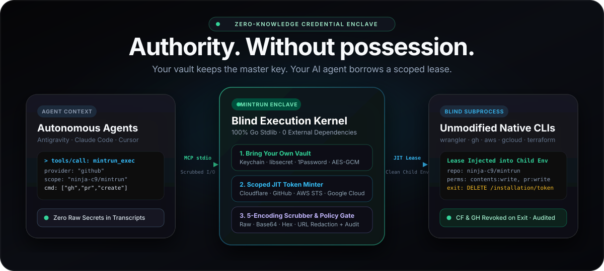
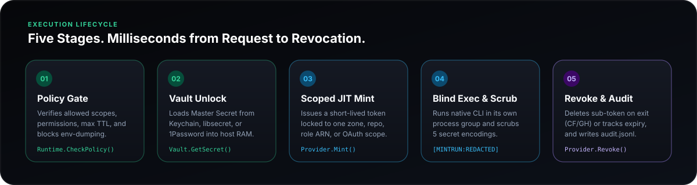
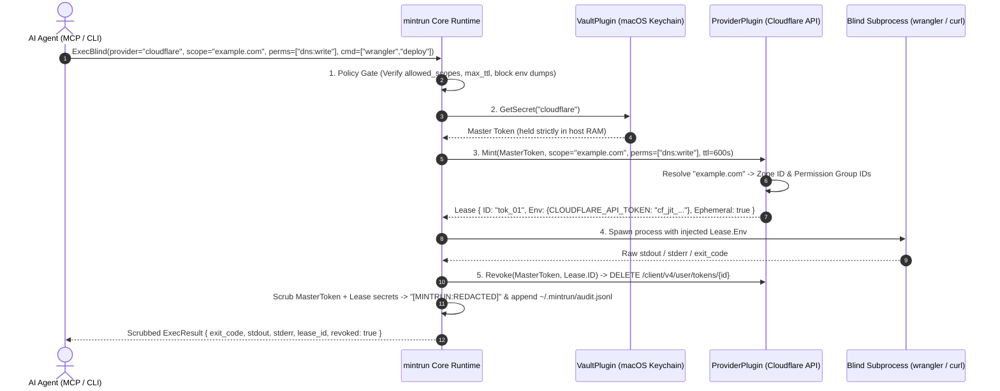
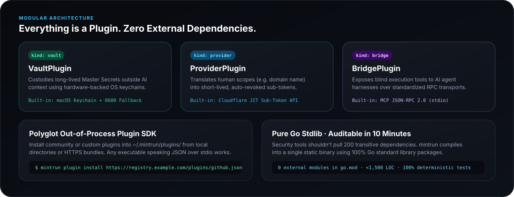

<div align="center">



<br />

# mintrun

### **Give AI agents the authority to deploy. Never the raw keys.**

Zero-knowledge Just-In-Time (JIT) credential minter, blind CLI runner, and MCP enclave.<br />
Built with **100% Go standard library**, **zero external dependencies**, and an **Everything is a Plugin** architecture.

<p align="center">
  <a href="https://github.com/ninja-c9/mintrun/blob/main/go.mod"></a>
  <a href="#architecture-everything-is-a-plugin"></a>
  <a href="#ai-agent-integration-mcp"></a>
  <a href="#defense-in-depth-security-model"></a>
</p>

<p align="center">
  <a href="#the-vision">The Vision</a> ·
  <a href="#how-it-works">How It Works</a> ·
  <a href="#architecture-everything-is-a-plugin">Architecture</a> ·
  <a href="#quick-start">Quick Start</a> ·
  <a href="#ai-agent-integration-mcp">MCP Integration</a> ·
  <a href="#defense-in-depth-security-model">Security &amp; Policy</a> ·
  <a href="#polyglot-plugin-sdk">Plugin SDK</a> ·
  <a href="#roadmap">Roadmap</a>
</p>

</div>

---

## The Vision

Modern AI coding agents (**Google Antigravity**, **Claude Code**, **Cursor**, **Windsurf**, **Codex**) are no longer passive autocomplete tools—they actively deploy Cloudflare Workers, update DNS records, manage GitHub releases, and run Terraform plans.

Yet the way we grant credentials to AI agents today is fundamentally broken:

| Dimension | The Legacy `.env` / Static Token Way | The **mintrun** Enclave Way |
| :--- | :--- | :--- |
| **Where secrets live** | Plaintext `.env` files, shell profiles, or MCP JSON configs | Hardware-backed **OS Native Keychain** (`VaultPlugin`) |
| **What the AI sees** | Full, long-lived API tokens inside the LLM context window | **Zero raw secrets.** The agent only requests a command & scope |
| **Blast radius** | Account-wide or multi-zone permanent keys | **JIT Sub-Token** locked to 1 zone/repo & specific permissions |
| **Token lifetime** | Weeks, months, or never rotated | **Seconds.** Automatically revoked (`DELETE`) the instant the CLI exits |
| **Accidental stdout leak** | Printed into terminal logs & uploaded to LLM cloud transcripts | Automatically scrubbed with `[MINTRUN:REDACTED]` before returning |
| **Exfiltration guard** | Agent can run `env` or `printenv` freely | Built-in **Policy Engine** blocks env-dumping & unauthorized scopes |

> **Core Philosophy — Separate Authority from Possession:**
> An AI agent does not need to *possess* your Cloudflare or GitHub API key to run `wrangler deploy` or `gh release create`. It only needs a trusted local enclave to execute that binary with a short-lived, narrowly scoped credential and return the scrubbed result.

---

## How It Works

<div align="center">
  
</div>

Every time you—or an AI agent via MCP—invoke `mintrun exec`, the runtime executes a deterministic five-stage lifecycle:



---

## Architecture (`Everything is a Plugin`)

<div align="center">
  
</div>

`mintrun` is engineered around a tiny, zero-dependency Go kernel (`internal/core`) where every capability—secret storage, credential minting, and agent transport—is a pluggable contract:

| Plugin Kind | Go Interface | Responsibility | Built-in Implementation |
| :--- | :--- | :--- | :--- |
| **`vault`** | `core.VaultPlugin` | Stores and retrieves long-lived master credentials outside agent context | **`keychain`** — macOS Keychain (`/usr/bin/security`) with `0600` local encrypted-path fallback (`~/.mintrun/vault.json`) |
| **`provider`** | `core.ProviderPlugin` | Mints short-lived, resource-scoped sub-tokens from a master secret and revokes them on exit | **`cloudflare`** — Resolves domain names to Zone IDs, maps human permissions (`dns:write`, `workers:write`), mints via `POST /client/v4/user/tokens`, and revokes via `DELETE /client/v4/user/tokens/{id}` |
| **`bridge`** | `core.BridgePlugin` | Exposes `mintrun` capabilities to external AI agent harnesses | **`mcp`** — Full Model Context Protocol (JSON-RPC 2.0 over `stdio`) server exposing `mintrun_exec` and `mintrun_plugins` |

### Repository Layout

```text
mintrun/
├── cmd/mintrun/
│   └── main.go                 # CLI entrypoint (exec, secret, plugin, mcp, audit)
├── internal/
│   ├── core/
│   │   ├── plugin.go           # Plugin ABI, Registry, and JSON-over-stdio ExternalPlugin SDK
│   │   ├── runner.go           # ExecBlind lifecycle, Policy Engine, Stream Scrubber, Audit Logger
│   │   └── core_test.go        # End-to-end JIT mint, scrub, revoke, policy & MCP test suite
│   └── builtin/
│       ├── keychain.go         # Native macOS Keychain vault + 0600 file fallback
│       ├── cloudflare.go       # Cloudflare JIT Sub-Token minter & zone resolver
│       └── mcp.go              # MCP JSON-RPC 2.0 stdio bridge server
└── docs/assets/                # Architectural diagrams & visual assets
```

---

## Quick Start

### 1. Install `mintrun`

```bash
# Install directly via Go 1.24+:
go install github.com/ninja-c9/mintrun/cmd/mintrun@latest

# Or clone and build from source:
git clone https://github.com/ninja-c9/mintrun.git
cd mintrun
go build -o mintrun ./cmd/mintrun
```

### 2. Enroll Your Master Secret Once

Create a Cloudflare API Token that includes the **`User -> API Tokens -> Edit`** permission (this allows `mintrun` to dynamically mint and revoke disposable child tokens on your behalf) and store it in your macOS Keychain:

```bash
# Prompts interactively on stdin so your master token never appears in shell history:
./mintrun secret set cloudflare

# Verify existence without ever printing the secret value:
./mintrun secret check cloudflare
# -> Secret "cloudflare" is configured in vault "keychain" (length=40 chars, value hidden).
```

### 3. Run Commands Blindly with JIT Scoped Tokens

```bash
# Dynamically mint a sub-token locked ONLY to `example.com` with DNS + Workers write access,
# run Wrangler, scrub stdout/stderr, and immediately revoke the sub-token when Wrangler exits:
./mintrun exec \
  -provider cloudflare \
  -scope example.com \
  -perms dns:write,workers:write \
  -ttl 300 \
  -- npx wrangler deploy
```

> **Static Wrapper Mode:** Already have a pre-scoped token and just want zero-knowledge injection + stream scrubbing without calling `/user/tokens`? Pass `-perms static`:
> ```bash
> ./mintrun exec -provider cloudflare -perms static -- npx wrangler whoami
> ```

### 4. Inspect the Zero-Secret Audit Trail

Every execution is recorded in `~/.mintrun/audit.jsonl` with lease metadata, exit code, and revocation confirmation—never raw secrets:

```bash
./mintrun audit
```
```json
{"ts":"2026-10-15T04:20:00Z","provider":"cloudflare","scope":"example.com","permissions":["dns:write","workers:write"],"command":["npx","wrangler","deploy"],"lease_id":"9a8b7c6d5e","ephemeral":true,"revoked":true,"exit_code":0,"duration_ms":1840}
```

---

## AI Agent Integration (MCP)

Add `mintrun` to **Google Antigravity**, **Claude Code**, or **Cursor** so your agent can run authenticated infrastructure commands autonomously without ever touching your API keys:

```json
{
  "mcpServers": {
    "mintrun": {
      "command": "/path/to/mintrun",
      "args": ["mcp"]
    }
  }
}
```

### Exposed MCP Tools

| Tool Name | Description | Key Parameters |
| :--- | :--- | :--- |
| **`mintrun_exec`** | Mints a scoped JIT credential, runs the target CLI command in a blind subprocess, scrubs all secret strings from `stdout`/`stderr`, and revokes the credential before returning. | `provider` (`"cloudflare"`), `scope` (`"example.com"`), `permissions` (`["dns:write","workers:write"]`), `command` (`["wrangler","deploy"]`), `cwd`, `ttl_seconds` |
| **`mintrun_plugins`** | Lists all registered built-in and external plugins (`vault`, `provider`, `bridge`) along with their supported permission scopes. | *(none)* |

---

## Defense-in-Depth Security Model

### 1. Declarative Policy Guardrails (`~/.mintrun/policy.json`)

You can restrict which domains/scopes an AI agent is allowed to touch, cap maximum lease TTLs, and block dangerous CLI flags per provider by creating `~/.mintrun/policy.json`:

```json
{
  "cloudflare": {
    "allowed_scopes": ["staging.example.com", "sandbox.example.com"],
    "blocked_commands": ["delete", "r2 bucket delete", "curl"],
    "max_ttl_seconds": 300
  },
  "github": {
    "allowed_scopes": ["ninja-c9/*"],
    "blocked_commands": ["repo delete", "secret"],
    "max_ttl_seconds": 600
  }
}
```

### 2. Anti-Exfiltration Command Filter

Even without a custom `policy.json`, `mintrun` automatically blocks trivial environment-dumping commands (`env`, `printenv`, `export`, `/proc/self/environ`) at the policy gate before any secret is unlocked or minted.

### 3. Multi-Vector Output Scrubber

Before `ExecBlind` returns `stdout`, `stderr`, or process error messages to the caller or MCP bridge, `core.Scrub()` replaces every occurrence of:
1. The **Master Secret**
2. Every injected **`Lease.Env`** value
3. Any additional provider-specified **`Lease.Redact`** tokens

with `[MINTRUN:REDACTED]`.

---

## Polyglot Plugin SDK

Because **everything in `mintrun` is a plugin**, you can extend `mintrun` with new Vaults (1Password, Bitwarden, OpenBao/Vault) or Providers (GitHub Apps, AWS STS, Vercel, Supabase, DigitalOcean) in **any language** without recompiling the binary.

### Managing Plugins

```bash
# List all built-in and external plugins
./mintrun plugin list

# Install from a local directory containing plugin.json + executable entrypoint
./mintrun plugin install ./examples/plugins/github

# Install a single-file remote plugin bundle over HTTPS
./mintrun plugin install https://registry.example.com/plugins/github.json

# Remove an external plugin
./mintrun plugin remove github
```

### Writing an External Plugin (`stdin` $\rightarrow$ `stdout` JSON Protocol)

Place a `plugin.json` manifest and an executable entrypoint inside `~/.mintrun/plugins/<name>/`:

**1. `plugin.json`**
```json
{
  "name": "github",
  "version": "0.1.0",
  "kind": "provider",
  "description": "GitHub App Installation Token JIT Minter",
  "entrypoint": "run",
  "scopes": ["repo:read", "contents:write", "pull_requests:write"]
}
```

**2. Request Payload (`stdin` to `entrypoint`)**
```json
{
  "op": "mint",
  "master_secret": "<resolved-from-vault>",
  "mint_request": {
    "provider": "github",
    "scope": "ninja-c9/mintrun",
    "permissions": ["contents:write"],
    "ttl_seconds": 600
  }
}
```

**3. Response Payload (`stdout` from `entrypoint`)**
```json
{
  "lease": {
    "id": "gh-inst-lease-01",
    "provider": "github",
    "scope": "ninja-c9/mintrun",
    "env": {
      "GITHUB_TOKEN": "ghs_shortLivedInstallationToken",
      "GH_TOKEN": "ghs_shortLivedInstallationToken"
    },
    "redact": ["ghs_shortLivedInstallationToken"],
    "ephemeral": true
  }
}
```

 When the child command finishes, `mintrun` invokes your plugin again with `{"op": "revoke", "master_secret": "...", "lease": {...}}` so your plugin can immediately invalidate the token.

---

## Roadmap

`mintrun` is actively evolving toward a complete zero-trust execution standard for autonomous AI agents:

| Milestone | Status | Key Deliverables |
| :--- | :---: | :--- |
| **`v0.1.0` — Core Runtime & Enclave ABI** | ✅ **Done** | • Zero-dependency Go core runtime & `Vault` / `Provider` / `Bridge` ABI<br />• Native macOS Keychain vault + `0600` local fallback<br />• Cloudflare JIT Sub-Token provider (auto zone resolution + instant `DELETE` revoke)<br />• MCP JSON-RPC 2.0 `stdio` bridge (`mintrun_exec`, `mintrun_plugins`)<br />• Stream Scrubber, Policy Engine (`policy.json`), and JSONL Audit Logger |
| **`v0.2.0` — Multi-Cloud JIT Providers & Vaults** | ✅ **Done** | • **Built-in GitHub App & PAT Provider (`github`)**: RS256 JWT signing + repo/permission-scoped installation token minting & instant `DELETE /installation/token` revocation<br />• **Built-in 1Password CLI (`op`) Vault (`1password`)**: Biometric TouchID unlock & `op://` URI support |
| **`v0.3.0` — Enclave Hardening & HITL Approval** | ✅ **Done** | • **Encoding-Aware Scrubber**: Redacts raw, Base64, RawBase64, Hex, and URL-encoded secret leaks<br />• **Human-in-the-Loop (HITL) Prompt (`-approve` / `require_approval`)**: Native macOS `osascript` Security Enclave confirmation gate<br />• **SHA-256 Remote Plugin Integrity**: Cryptographic digest pinning (`#sha256=...`) for remote plugin bundles |
| **Phase 4 — Ecosystem & Enterprise Telemetry (`v0.4`)** | 🔭 **Next** | • **AWS STS (`AssumeRole`) & Supabase/Vercel Built-in Providers**<br />• **Community Plugin Index**: Curated discovery registry<br />• **Team Audit Telemetry**: Optional OpenTelemetry / webhook streaming for enterprise agent governance |

---

## Verification & Testing

`mintrun` ships with a deterministic, offline unit and integration test suite that mocks the Cloudflare Token API, verifies secret injection, tests accidental leak scrubbing, enforces `printenv` policy denials, and validates external plugin execution over MCP:

```bash
go test -v ./...
```

---

<div align="center">
  <sub>Built with precision for the autonomous agent era · <b>mintrun</b></sub>
</div>
