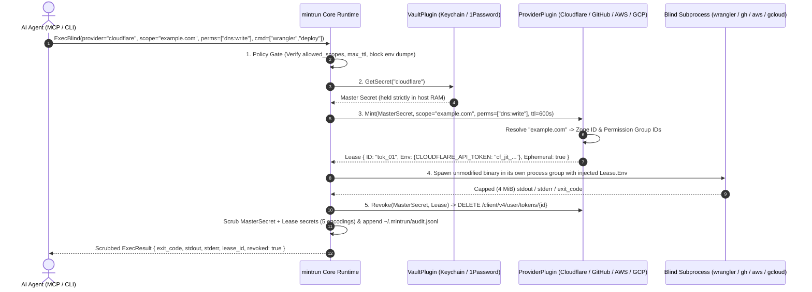

<div align="center">


<br />

# mintrun

### **Authority. Without possession.**

The zero-knowledge Just-In-Time (JIT) credential enclave, blind CLI runner, and MCP server for autonomous AI agents.<br />
Engineered with **100% Go standard library**, **zero external dependencies**, and an **Everything is a Plugin** architecture.

<p align="center">
  <a href="https://github.com/ninja-c9/mintrun/blob/main/go.mod"></a>
  <a href="#architecture"></a>
  <a href="#ai-agent-integration-mcp"></a>
  <a href="#verification--testing"></a>
  <a href="LICENSE"></a>
</p>

<p align="center">
  <a href="#why-mintrun">Why mintrun</a> ·
  <a href="#how-it-works">How It Works</a> ·
  <a href="#architecture">Architecture</a> ·
  <a href="#quick-start">Quick Start</a> ·
  <a href="#built-for-every-cli">Cloud CLIs</a> ·
  <a href="#ai-agent-integration-mcp">MCP Integration</a> ·
  <a href="#security-model">Security &amp; Policy</a> ·
  <a href="#plugin-sdk">Plugin SDK</a> ·
  <a href="#documentation">Docs</a>
</p>

</div>

---

## Why mintrun

### **Your vault keeps the master key. Your agent borrows a scoped lease.**

AI coding agents (**Google Antigravity**, **Claude Code**, **Cursor**, **Windsurf**, **Codex**) deploy Cloudflare Workers, open GitHub pull requests, assume AWS roles, and inspect Google Cloud storage.

Yet every existing way of handing credentials to an agent forces a bad trade-off:
- **Plaintext `.env` files & MCP configs** expose long-lived keys directly to the LLM context window and cloud transcripts.
- **Static CLI wrappers (`op run`, `doppler run`, decoy shims)** hide the file on disk, but still inject your full-privilege static token into the child process, miss encoded stdout leaks (Base64, Hex, URL), and offer no scope-down or policy gate.
- **Cloud-locked agent vaults** force you to migrate your secrets out of macOS Keychain or 1Password into a third-party cloud just to run local CLIs.

`mintrun` takes a fundamentally different approach: **Bring Your Own Vault + True JIT Scope-Down + Blind Native CLI Execution.**

| Dimension | Plaintext `.env` / MCP Configs | Static CLI Wrappers (`op run` / Shims) | **The `mintrun` Enclave** |
| :--- | :--- | :--- | :--- |
| **Where master secrets live** | `.env` files, shell profiles, or MCP JSON | Existing vault, or a proprietary cloud vault | **Your existing vault** (`keychain`, `libsecret`, `1password`, or AES-256-GCM local fallback) |
| **What the AI agent sees** | Raw, long-lived API tokens in LLM context | Zero raw tokens, unless echoed in an encoded form | **Zero raw secrets.** The agent requests a provider, a scope, permissions, and a command |
| **What the child CLI receives** | Account-wide permanent credential | Account-wide permanent credential | **Narrowly scoped JIT sub-token** locked to 1 zone, 1 repo, 1 IAM role ARN, or specific OAuth2 scopes |
| **Token lifetime** | Weeks, months, or never rotated | Weeks, months, or never rotated | **Seconds to minutes.** Cloudflare & GitHub sub-tokens are deleted (`DELETE`) the instant the command exits; AWS STS & GCP tokens cannot be revoked early and expire on their own (AWS ≥ 15 min, GCP ≤ 1 h) |
| **Stdout / Stderr scrubbing** | None | Exact raw string match only | **5-Encoding Scrubber** redacts Raw, Base64, RawBase64, Hex, and URL-encoded forms with `[MINTRUN:REDACTED]` |
| **Exfiltration & policy gate** | None | None | **Fail-closed `policy.json`** blocks `env`/`printenv`, restricts scopes/permissions, isolates child env, and can ask a human first (the mintrun macOS app or a dialog, Telegram, or Slack) |
| **Supply-chain footprint** | N/A | Dozens to hundreds of external packages | **0 external dependencies.** 100% Go 1.24 standard library |

> **Design Principle — Separate Authority from Possession:**
> An AI agent never needs to *possess* your Cloudflare token, GitHub App key, AWS secret key, or GCP service-account JSON to run `wrangler`, `gh`, `aws`, or `gcloud`. Your unmodified native CLIs already read standard environment variables—`mintrun` simply mints a disposable credential in memory, runs the binary blindly, scrubs the output, and revokes the lease on exit.

---

## How It Works

<div align="center">
  
</div>

Every time you—or an AI agent over MCP—invoke `mintrun exec`, the runtime executes a deterministic five-stage pipeline:



Stage 5 reports revocation honestly. **Cloudflare** and **GitHub** delete the sub-token immediately over the API, so `revoked: true`. **AWS STS** and **Google Cloud** service-account tokens cannot be invalidated early server-side, so the result reports `revoked: false` and the credentials live until their expiry.

---

## Architecture

`mintrun` is a small Go kernel (`internal/core`) with three plugin kinds, each a Go interface: **vaults** keep master secrets (`keychain`, the macOS Keychain or Linux libsecret with an encrypted file fallback, and `1password`), **providers** mint scoped leases and revoke them where the API allows (`cloudflare`, `github`, `aws`, `gcp`), and **bridges** expose `mintrun` to agents (`mcp`). Plugins in any language add vaults and providers (see the [Plugin SDK](#plugin-sdk)). The plugin table and the repository layout are in [docs/architecture.md](docs/architecture.md).

---

## Quick Start

### 1. Install `mintrun`

```bash
# Homebrew (macOS and Linux):
brew install ninja-c9/mintrun/mintrun

# Or with Go 1.24+:
go install github.com/ninja-c9/mintrun/cmd/mintrun@latest

# Or clone and build a reproducible binary from source:
git clone https://github.com/ninja-c9/mintrun.git
cd mintrun
go build -trimpath -o mintrun ./cmd/mintrun

# Print the version, Go version, and platform:
./mintrun -version
```

Or download an archive for macOS or Linux (arm64 or amd64) from [Releases](https://github.com/ninja-c9/mintrun/releases) and check it against `SHA256SUMS`. The macOS binaries are signed with a Developer ID and notarized by Apple; `SHA256SUMS` itself is not signed.

### 2. Set Up With `mintrun init`

`mintrun init` walks through the setup one step at a time and asks before each: a master secret for GitHub, AWS, Google Cloud, or Cloudflare, approval through Telegram or Slack, a starting policy, and the MCP entry in your IDEs. `mintrun doctor` then checks what is in place.

```bash
./mintrun init              # every step, each after a yes
./mintrun init github       # one step: github, aws, gcp, cloudflare, telegram, slack, policy, or mcp
./mintrun doctor            # check the setup; exits 1 if any check fails
./mintrun scan              # list keys gh, aws, gcloud, and wrangler already keep (reads only); scan -add <id> copies one
```

- **Checked before it is stored.** A GitHub App ID and installation ID must be digits, and the App's private key must parse; leave the installation ID empty and each request picks one, which `init` tells you to limit with `allowed_installations`. An AWS access key ID must look like `AKIA…` or `ASIA…`, and an `ASIA` key needs its session token. A Google Cloud key file needs a `client_email` and a `private_key` that parses. Tokens and secret keys are typed with echo off, private keys and key files are read from their path, and a stored secret is replaced only after a yes.
- **A policy that starts closed.** `init policy` suggests a rule for one repository, taken from the current directory's `origin` remote (the remote URL, which can hold a token, is never printed), with `clean_env` on, `sandbox` on when this host can run the sandbox (`Runtime.SandboxReady()` checks the same resolver `exec` runs; when it is ready `init` prints a note that keystore/D-Bus logins fail inside and the network stays open, and when it is not ready `init` prints `Sandbox: not suggested: <cause>` with no path and omits `sandbox`), and `allow_static` off. It writes `policy.json` only after a yes and only when there is none: an existing one is never changed, and `init` prints the rule to add to it instead.
- **Each IDE its own way.** `init mcp` adds Claude Code with `claude mcp add -s user`, shows Cursor's install link (and opens it on macOS after a yes), and edits Claude Desktop's or Antigravity's config only after a yes, keeping a timestamped backup and every other entry. The entry runs this binary by its absolute path and carries no environment, so `MINTRUN_VAULT_KEY` never lands in a config. With the encrypted file vault, an IDE started from the Dock or an app launcher may not get your shell's `MINTRUN_VAULT_KEY`: start it from that shell, or use the macOS Keychain or libsecret, which need no passphrase.
- **`doctor` only reads.** It reports the binary and whether `PATH` runs it, the vault and which providers and accounts have a master secret, the approval settings, `policy.json` (including a field `exec` would ignore, such as a misspelling), and each IDE's `mintrun` entry. It prints names, never a secret, its length, or an IDE config's contents, and calls no cloud or chat API.

### 3. Or Enroll a Master Secret by Hand

Store your master credential in the OS keystore yourself. `mintrun` never modifies or replaces your existing cloud CLIs—it injects ephemeral credentials at runtime.

```bash
# Prompts on stdin with terminal echo off, so your master secret never appears
# on screen, in shell history, or in `ps`:
./mintrun secret set cloudflare

# Verify existence without ever printing the secret value:
./mintrun secret check cloudflare
# -> Secret "cloudflare" is configured in vault "keychain" (value hidden).
# A missing secret prints the command that stores it, and a vault that cannot be read
# (such as a wrong MINTRUN_VAULT_KEY) says so with the vault's error. Both exit 1.

# Piped or redirected input is read whole, so multi-line secrets such as a GCP
# service-account JSON key or a GitHub App PEM survive intact (and stay off argv):
./mintrun secret set gcp < sa-key.json
```

`mintrun secret set <provider> <secret>` still works, but prints a warning: an argument is visible in shell history and `ps`. On macOS, a secret too long for one `security -i` line (about 2 KB, such as a GCP service-account JSON or a GitHub App PEM) is split across up to 16 Keychain items, 24,000 bytes in all; a longer one is stored in the encrypted file vault with a warning, and that needs `MINTRUN_VAULT_KEY` set.

`mintrun` reads the Keychain or libsecret before the encrypted file vault, so `secret set` removes the older copy from the other store: a keystore store removes the file-vault copy (without `MINTRUN_VAULT_KEY` it cannot decrypt `vault.json`, so it warns that the copy may remain), and a store that falls back to the file vault removes the keystore item. If the keystore exists but cannot be reached (for example, `secret-tool` without a D-Bus session), that removal can fail too, and `secret set` then exits non-zero after storing the secret in the file vault. On such a host, set `MINTRUN_FILE_VAULT=1` wherever `mintrun` runs (your shell and the MCP server config) to use only the encrypted file vault.

### 4. Settings (`~/.mintrun/settings.json`)

The mintrun macOS app keeps two settings in `~/.mintrun/settings.json`, and you can write the file yourself:

```json
{ "vault": "keychain", "approval_timeout_seconds": 300 }
```

- **`vault`** picks where master secrets live: `keychain` (the macOS Keychain or Linux libsecret, then the encrypted file vault; the default), `1password`, or `file` (the encrypted file vault only, like `MINTRUN_FILE_VAULT=1`). A non-empty `MINTRUN_VAULT`, or `MINTRUN_FILE_VAULT=1`, wins over it. Switching moves no secrets: store each one again in the new vault.
- **`approval_timeout_seconds`** (1 to 600, default 600) is how long [approval](docs/approvals.md) waits before the request is not approved.
- **Read once, at start.** A running `mintrun mcp` keeps the old values until its AI app restarts it.
- **Checked.** Unknown keys are ignored. Any other value for a known key, malformed JSON, or a file that exists but cannot be read stops `mintrun` with an error that names the cause, never the file's path. Only a missing file means no settings.

### 5. Multiple Accounts

Name a provider `<type>@<account>`, such as `github@work` or `cloudflare@client-a`, to keep several accounts of one provider type side by side. The whole alias is the vault key and the `policy.json` key, and a bare `github` is the default account, so a single-account setup works as before.

```bash
./mintrun init github -account work      # or answer init's "Account name" question; Enter stores the default account
./mintrun secret set github@work         # or store the master secret by hand
./mintrun secret check github@work
./mintrun exec -provider github@work -scope work-org/api -perms contents:read -- gh pr list -R work-org/api
```

```json
{
  "github":      { "allowed_scopes": ["ninja-c9/*"] },
  "github@work": { "allowed_scopes": ["work-org/*"], "require_approval": true }
}
```

- **The agent picks, you decide what exists.** An agent picks the account by naming the alias (MCP `mintrun_exec` and `mintrun_policy_check` take `"provider": "github@work"`), and you decide which aliases exist by storing their master secrets. An alias with no stored secret fails like any missing secret, with the command that stores it.
- **No inheritance.** `github@work` gets nothing from the `github` rule, and a request for `github` never falls through to an alias. An alias without its own rule is governed like any provider without one: any scope and permission the provider can mint, with static mode still refused. Give each alias you store its own rule; `mintrun init policy` suggests the same rule for the default account and each GitHub account it knows of.
- **Account names.** An account is 1 to 64 lowercase ASCII letters, digits, `.`, `_`, or `-`, other than `.` and `..`. `github@` and `github@Work` are refused, and `github@default` is just another account with its own secret. A `policy.json` key that is neither `<type>` nor `<type>@<account>` makes the file malformed, which denies every request until it is fixed.
- **The provider sees only its type.** `github@work` mints as `github` does, from the `github@work` secret, while the approval text, the audit log, and MCP replies name the alias. Every provider type works this way, plugins included, so a plugin's name cannot contain `@`.
- **Shims.** A shim runs as its tool's default account unless its `provider` in `~/.mintrun/shims/config.json` names another: `mintrun shim install -mode auto -provider github@work gh`. Without `-provider`, `shim install` asks which account to use when `policy.json` has rules for more than one, and Enter keeps the default.
- **Checking them.** `mintrun doctor` checks the secret of every alias that `policy.json` or the shim config names. `mintrun audit -provider github` lists the default account and every `github@` alias, while `-provider github@work` lists only that account.

---

## Built for Every CLI

`mintrun` wraps your unmodified native binaries (`wrangler`, `gh`, `aws`, `gcloud`, `terraform`, `curl`) and injects standard environment variables into the blind child process.

| Provider | Master secret | Lease the command gets | Revoked on exit |
| :--- | :--- | :--- | :--- |
| `cloudflare` | API token that can create tokens | Sub-token for the zones in `-scope` (`CLOUDFLARE_API_TOKEN`) | Yes, deleted |
| `github` | GitHub App ID, installation ID, and private key | Installation token for the repository in `-scope` (`GH_TOKEN`, `GITHUB_TOKEN`) | Yes, deleted |
| `aws` | IAM access key | `AssumeRole` session for the role ARN in `-scope`, narrowed to `-perms` | No, it expires (15 min at least) |
| `gcp` | Service-account JSON key | OAuth2 access token for the scopes in `-perms` | No, it expires (1 h at most) |

```bash
mintrun exec -provider github -scope owner/repo -perms contents:write,pull_requests:write -- gh pr create --fill
```

`mintrun init <provider>` stores and checks each master secret. Every provider's setup, an example per CLI, and static mode for a token you have already scoped are in [docs/providers.md](docs/providers.md).

### Intercept Direct CLI Calls (`mintrun shim`: Block & Redirect or Auto-Wrap)

Coding agents often default to running `gh`, `aws`, `gcloud`, `wrangler`, `vercel`, or `psql` directly in bash instead of calling `mintrun_exec`. Place `~/.mintrun/shims` ahead of standard binary directories on `PATH` to intercept those calls in either of two modes:

```bash
# 1. Block & Redirect mode (default): refuse direct CLI runs (exit 126) and print
# the exact `mintrun_exec` MCP call + `mintrun exec` command so the agent self-corrects.
# `shim install` then asks before it adds the PATH line to your shell profiles (see below):
./mintrun shim install gh aws gcloud wrangler

# 2. Transparent Auto-Wrap mode: intercept `gh ...` and route it through ExecBlind
# (policy gate -> JIT token mint -> 5-encoding scrub -> instant revoke on exit):
./mintrun shim install -mode auto -scope ninja-c9/mintrun -perms contents:read,pull_requests:write gh

# Inspect or remove shims (`mintrun doctor` also checks shim symlinks and PATH order):
./mintrun shim list
./mintrun shim remove gh
```

- **Mode 1 (`block`, default):** Exits `126` before opening any vault or spawning the binary, and prints a redirect message naming both the `mintrun_exec` MCP tool and the exact `mintrun exec -provider <provider> -scope <scope> -perms <perms> -- <tool> ...` command.
- **Mode 2 (`auto`):** Resolves the real binary on `PATH` (skipping `~/.mintrun/shims` and rejecting relative `PATH` entries), determines the target scope and permissions (from `shims/config.json`, `-R`/`--repo` or `git remote get-url origin` for `gh` without printing the remote URL, or a single concrete rule in `policy.json`), and runs the command through `ExecBlind`. `gh`, `gcloud`, and `wrangler` fall back to a read-only or narrow default; an `aws`, `vercel`, or `psql` shim left with no permission, or with a blank one, exits `126` before anything is minted and names what to set (`mintrun shim install -mode auto -perms <p1,p2> <tool>`, or concrete `allowed_permissions` in `policy.json`), because an empty list mints an AWS session with every permission of the role.
- **Environment tightening only:** Setting `MINTRUN_SHIM_MODE=block` forces even an `auto` shim into `block` mode for an agent subshell, whereas `MINTRUN_SHIM_MODE=auto` never loosens a `block` shim.
- **Shell profiles change only after you say yes:** `shim install` shows one line, `export PATH='<home>/shims':"$PATH" # mintrun-shim`, and the profiles it would go last in: `~/.zshenv` and `~/.zshrc` (created if missing), plus `~/.zprofile` and `~/.bashrc` if they exist. It goes last because Homebrew's line in `~/.zprofile` puts its own directory first. Then it asks `[y/N]`. Any answer but `y` or `yes` (Enter and EOF included) changes nothing, so you can add the line yourself. On a yes, each existing profile is first copied to `<file>.bak-<YYYYMMDD-HHMMSS>` with the same permissions. A profile that is a symlink (from a dotfiles repo, say) is edited where it points; a broken link is left alone. A profile that changed while the question was open is left unchanged, and `mintrun` stops and asks you to run the command again. Ctrl-C at the question stops `mintrun`. Open a new shell to use the shims. Once no shim is left, `shim remove` asks the same way and takes out only that exact line, so a line of your own that mentions `# mintrun-shim` stays. When the line already comes last in each profile, nothing is asked; `shim install` prints the `export` line if the current shell's `PATH` does not put the shims first.

### Inspect the Zero-Secret Audit Trail

Every request gets exactly one entry in `~/.mintrun/audit.jsonl`, a blocked or failed one too. It records the request's `task` handle, where it came from (`via`: `cli` for `mintrun exec` and the shims, `mcp` for an agent), lease metadata (`expires_at` for a lease that expires), exit code, revocation status, `truncated` when an output stream hit the 4 MiB cap, and how it ended:

- `outcome`: `done` (exit code 0), `blocked` (the policy gate refused it, and `blocked_by` names the check: `invalid_request`, `paused`, `purpose`, `policy_file`, `env_dump`, `static`, `scope`, `permission`, `installation`, `command`, or `sandbox`), `denied` (a human said no), `no_answer` (nobody answered by the approval deadline), `failed` (a non-zero exit, or every approval channel, the vault, or the provider failed), `stopped` (stopped from the mintrun app), `interrupted` (`mintrun` got a signal, or the MCP server shut down), or `timed_out` (the 5-minute limit).
- `decided_at`: when a human answered the approval.
- `sandbox: true` marks a request the gate let through, or asked a human about, with the sandbox on (and `no_network: true` when network egress was blocked too); one it blocked before that has none, and MCP `mintrun_audit` shows both fields as they are.
- An agent's request also records the AI app's name as `client` and the agent's `purpose`. Both are what the agent claims, never an identity.

Secrets the runner holds (master secret, lease credentials) are scrubbed. A policy-denied entry keeps its raw command because no secret is loaded yet, so never put a secret in `argv`; MCP `mintrun_audit` shows agents each entry's verdict but no text an agent wrote. `mintrun audit` and `mintrun_audit` read the file through `core.TailAudit` (seeking backward from the end of the file in 64 KiB chunks when `-limit > 0`, so it stops reading once it has the last `limit` matches instead of scanning a multi-megabyte log from the start):

```bash
./mintrun audit -provider cloudflare -limit 5
```
```json
{"ts":"2026-10-17T04:20:00Z","task":"EXAMPLETASKHANDLE234567ABC","via":"cli","provider":"cloudflare","scope":"example.com","permissions":["dns:write","workers:write"],"command":["npx","wrangler","deploy"],"outcome":"done","lease_id":"9a8b7c6d5e","ephemeral":true,"expires_at":"2026-10-17T04:30:00Z","revoked":true,"exit_code":0,"duration_ms":1840}
```

---

## AI Agent Integration (MCP)

Connect `mintrun` to **Google Antigravity**, **Claude Code**, **Cursor**, or **Windsurf** so your agent can execute authenticated CLI workflows without ever seeing raw credentials:

```json
{
  "mcpServers": {
    "mintrun": {
      "command": "/path/to/mintrun",
      "args": ["mcp"]
    }
  }
}
```

`mintrun init mcp` adds this entry for you (see [Quick Start](#quick-start)). Set `command` to the absolute path of a built binary, not a `go run` build, whose temporary binary is deleted when it exits, and give the entry no `env`: a `MINTRUN_VAULT_KEY` there lets anyone who can read the config decrypt the vault.

### Connect AI Apps With `mintrun apps`

`mintrun apps` adds, checks, or removes the same entry for Claude Code, Claude Desktop, and Cursor without asking, and prints one JSON row per app. The mintrun macOS app runs it this way:

```bash
./mintrun apps status
./mintrun apps connect -dry-run
./mintrun apps connect -app claude-desktop,cursor
./mintrun apps disconnect -app cursor
```

- **Unlike `init mcp`**, it never asks, updates an entry that runs another command, and writes Cursor's `~/.cursor/mcp.json` instead of opening its install link. Without `-app`, `connect` and `disconnect` skip an app that is not found (no `claude` on `PATH`, or no config folder). `status` reports each app's `found`, `installed`, and `matches` (the entry runs this binary with `mcp`); `connect` and `disconnect` report `add`, `update`, `remove`, or `none`, and `-dry-run` reports without changing anything. A row with an `error` makes it exit 1.
- **Claude Code** changes only through its own CLI (`claude mcp add` and `claude mcp remove`, user scope), found on `PATH`, and `init mcp`, `doctor`, and `apps` read `<CLAUDE_CONFIG_DIR>/.claude.json` when `CLAUDE_CONFIG_DIR` is an absolute path (surrounding space trimmed; a relative one is ignored in favor of `~/.claude.json`). An entry that also sets keys besides `type`, `command`, `args`, and an empty `env` is left alone, with an error that names those keys, never their values.
- **Claude Desktop and Cursor** get only the `mintrun` entry under `mcpServers` edited; every other byte of the file stays as it was, and connect then disconnect restores the original file when it already listed another server. A file that is not valid JSON, whose `mcpServers` or `mintrun` is not an object, or that repeats either key is refused. A config is created only when the app's own folder exists. A symlinked config is edited where it points, a broken link is refused, and a file that changed during the edit is left alone. The write is atomic and keeps the file's mode (`0600` for a new file).
- **The entry** runs this binary by its absolute path with `args: ["mcp"]`, and a new one has no `env`. Updating a Claude Desktop or Cursor entry rewrites only its `command` and `args`, so its other keys, an `env` included, stay. `-command` names another absolute path to an executable. A `go run` build is refused. The output names the command only, never an entry's args or env, or anything else in a config.
- **Tested against stand-ins and read-only on this host.** `go test` runs it against a stub `claude` and throwaway config files, and `mintrun doctor`, `mintrun apps status`, and `mintrun apps connect -dry-run` have also been run read-only against real Claude Code, Claude Desktop, Cursor, and Antigravity installs on macOS 27.0.

### Exposed MCP Tools

| Tool Name | Description | Key Parameters |
| :--- | :--- | :--- |
| **`mintrun_exec`** | Mints a scoped JIT credential, runs the target CLI command in a blind subprocess, scrubs all secret strings from `stdout`/`stderr`, and revokes the credential before returning where the provider allows it (AWS STS and GCP credentials can only expire; `revoked` reports which). Each output stream is capped at 4 MiB; `truncated: true` marks a cut. The command is killed after 5 minutes. | `provider` (`"cloudflare"`, or an account such as `"github@work"`), `scope` (`"example.com"`), `permissions` (`["dns:write","workers:write"]`; required, at least one and none blank, or `["static"]`), `command` (`["wrangler","deploy"]`), `cwd`, `ttl_seconds`, `clean_env`, `sandbox` (`true` runs the command in the [macOS or Linux sandbox](docs/security-model.md#1-declarative-policy-guardrails-mintrunpolicyjson)), `no_network` (`true` also blocks network egress inside the sandbox, and turns `sandbox` on), `params` (`{"installation_id":"12345678"}` picks a `github` App installation), `approve` (`true` asks a human first), `purpose` (why, in one line of at most 300 bytes, shown to the approver as the agent's claim) |
| **`mintrun_plugins`** | Lists all registered built-in and external plugins (`vault`, `provider`, `bridge`) along with their supported permission scopes. | *(none)* |
| **`mintrun_policy_check`** | Dry-runs a `mintrun_exec` request against `policy.json` and the anti-exfiltration guard, through the same gate `mintrun_exec` enforces. Never opens the vault, mints, runs the command, or asks a human. Returns `allowed`, the denial `reason` (the exact error `mintrun_exec` would return), `approval_required`, `ttl_seconds` (the TTL requested from the provider after `max_ttl_seconds`; `gcp` tokens always live up to 1h), `clean_env`, `sandbox`, and `no_network`. | Same as `mintrun_exec` |
| **`mintrun_audit`** | Returns recent audit entries, oldest first, filtered like `mintrun audit`. Each entry keeps its verdict (`outcome`, `blocked_by`, `exit_code`), `task`, `via`, `client`, `lease_id`, and timestamps, but no text an agent wrote: `scope`, `permissions`, and `purpose` are blank, an `error` reads `[MINTRUN:REDACTED]`, and each command is cut to its binary name plus `[MINTRUN:REDACTED]`. A policy-denied entry keeps the raw `argv` (no secret is loaded yet to scrub against), and a secret typed into `argv` is one the runner never holds, so arguments never reach an agent. The on-disk log keeps every field for the operator. | `provider` (case-insensitive; `github` also matches every `github@` account), `failed_only`, `limit` (default 20, max 100) |

The vault is yours to pick, never the agent's: `mintrun mcp` reads every master secret from the vault it was started with (`MINTRUN_VAULT`, or `keychain`). A `mintrun_exec` or `mintrun_policy_check` request that names a vault (`vault`), even that same one, is denied with the same reason by both, and the denied `mintrun_exec` goes to the audit log like any other denial. Nor does an agent set the time limit: its command is killed after 5 minutes, like one run with `mintrun exec`, and a request that sets `timeout_seconds` is denied the same way.

### Human Approval

`-approve`, `MINTRUN_APPROVE=1`, or `"require_approval": true` in a provider's rule asks a person before anything is minted. The mintrun macOS app (or `mintrun watch`'s local dashboard), a macOS dialog when no app listens, Telegram (`mintrun init telegram`), and Slack (`mintrun init slack`) all ask at once, and the first answer wins. The dialog's default button is Deny, and no answer within 10 minutes is a no. Setup, and what Telegram and Slack see, are in [docs/approvals.md](docs/approvals.md).

---

## Security Model

[docs/security-model.md](docs/security-model.md) explains each layer, and the [threat model](docs/threat-model.md) lists what `mintrun` promises, the tests behind each promise, and where each one stops. To report a vulnerability, see [SECURITY.md](SECURITY.md).

1. **[Policy](docs/security-model.md#1-declarative-policy-guardrails-mintrunpolicyjson)** (`~/.mintrun/policy.json`): the scopes, permissions, and commands each provider allows, a TTL cap, a clean child environment, human approval, and the OS sandbox.
2. **[Env-dump filter](docs/security-model.md#2-anti-exfiltration-command-filter):** `env`, `printenv`, `export`, and `/proc/self/environ` are blocked before any secret is loaded.
3. **[Output scrubber](docs/security-model.md#3-five-encoding-output-scrubber):** the master secret and every lease value are replaced in raw, Base64, hex, and URL-encoded form before output reaches the agent or the audit log.
4. **[Bounded output and process-group kill](docs/security-model.md#4-bounded-output--process-group-kill):** 4 MiB per stream, and a timeout, a stop, or Ctrl-C kills the command's whole process group; the lease is still revoked and audited.
5. **[What the vault protects, and what it does not](docs/security-model.md#5-what-the-vault-protects-and-what-it-does-not):** a command running as your user can query the keystore itself unless the sandbox is on.
6. **[`no_network`](docs/security-model.md#6-optional-network-isolation-no_network):** the sandbox, with the command's network blocked.
7. **[Team relay](docs/security-model.md#7-team-relay-mintrun-relay)** (`mintrun relay`): master secrets stay on one server, and laptops get leases over TLS 1.3 pinned to the server's key.
8. **[Semantic screen](docs/security-model.md#8-semantic-screen-optional-through-typesafe-ai)** (optional, off by default): one TypeSafe AI call per request that can only ask a person or deny, never allow.

---

## Plugin SDK

A plugin adds a vault or a provider in any language without rebuilding `mintrun`: a `plugin.json` and an executable that reads one JSON request on `stdin` and writes one JSON reply on `stdout`. Three ship in the binary (`bitwarden`, `vercel`, and `postgres-jit`; `mintrun plugin install <name>`), and a plugin cannot take a built-in's name. The protocol and the install commands are in [docs/plugins.md](docs/plugins.md).

---

## Roadmap

The milestones from `v0.1.0` to `v0.14.0`, and what each shipped, are in [docs/roadmap.md](docs/roadmap.md).

> **Breaking changes in `v0.16.0` (multiple accounts):** `mintrun exec` requires `-provider` (it used to default to `cloudflare`) and `-perms` (it used to default to `dns:write,workers:write`, Cloudflare's permissions, whatever the provider), so a script that relied on either default stops with the usage line until it names one. A `-perms` that holds no permission (`-perms ""`, or an unset `-perms "$PERMS"`) stops the same way, because an empty list mints a GitHub token with every permission the installation holds and an AWS session with every permission of the role; `-perms static` still asks for static mode. A plugin provider that ignores permissions (`vercel`, `postgres-jit`) still needs one: name what the command does, such as `-perms deploy`, which `allowed_permissions` can pin. The same goes for agents and shims: a `mintrun_exec` or `mintrun_policy_check` call, or a relay request, that omits `permissions` or sends an empty or blank one is denied (`blocked_by: invalid_request`, exit 126, audited), and an `aws`, `vercel`, or `psql` shim in `auto` mode with no permissions configured stops with exit 126 and names the `shims/config.json` key to set. Every `policy.json` key must be a provider name, `<type>` or `<type>@<account>` with a lowercase account, or the file is malformed and exec denies every request. A plugin name can no longer contain `@`. Each provider step of `mintrun init` first asks for an account name, so answers piped into it need one more line (an empty one keeps the default account). Nothing else changes for a single-account setup: the bare name (`github`) is the default account, under the same vault key and the same rule as before. See [Multiple Accounts](#5-multiple-accounts).

---

## Documentation

- [Architecture](docs/architecture.md): the plugin kinds and the repository layout
- [Providers](docs/providers.md): Cloudflare, GitHub, AWS, and Google Cloud, and static mode
- [Approvals](docs/approvals.md): the mintrun app, `mintrun watch`, the macOS dialog, Telegram, and Slack
- [Security model](docs/security-model.md): policy, the scrubber, the vault, the sandbox, `no_network`, the team relay, and the semantic screen
- [Threat model](docs/threat-model.md): each promise, the tests behind it, and its limits
- [Plugin SDK](docs/plugins.md): writing and installing a plugin
- [Milestones](docs/roadmap.md): `v0.1.0` to `v0.14.0`
- [SECURITY.md](SECURITY.md): reporting a vulnerability

---

## Verification & Testing

`mintrun` ships with a deterministic, offline unit and integration test suite (**95.1%** total statement coverage, measured without build tags) that mocks Cloudflare, GitHub App RS256, AWS STS SigV4 (plus a fixed AWS signing vector), Google OAuth2 JWT-bearer, Telegram Bot, and Slack Web APIs plus the macOS `security`, `osascript`, and `sandbox-exec`, Linux `secret-tool` and the user+mount namespace sandbox helper, 1Password `op`, and `stty` CLIs, exercises the TLS 1.3 SPKI-pinned team relay (`mintrun relay`) and `mintrun watch` companion controller end to end, checks child environment isolation, the sandbox gate, the output cap, and the process-group kill, verifies AES-256-GCM encryption at rest, tests multi-encoding leak scrubbing, enforces policy guardrails, validates external plugin execution and the governance tools over MCP, installs and runs the [example plugins](examples/plugins/README.md) against a stub `bw`, a stub `psql`, and a local Vercel API (skipped without `python3`), runs `mintrun init`, `mintrun doctor`, `mintrun shim`, and `mintrun apps` in a throwaway home directory against stub `git`, `claude`, and `open`, and asks the mintrun app over a local test socket. It never touches the real Keychain, Telegram, Slack, Bitwarden, Vercel, a database, the mintrun app, or your IDE configs:

```bash
# Every acceptance check at once (gofmt, go vet, tests with a coverage gate above 90%, build, smoke test), then a check | verdict table
scripts/verify.sh

go test -v -cover ./...

# macOS only: round-trip throwaway single-item and multi-part secrets through the real Keychain
go test -tags integration -count=1 -v -run TestKeychainVaultRealKeychain ./internal/builtin

# macOS and Linux: run real commands inside the OS sandbox against a throwaway home and keystore folder
go test -tags integration -count=1 -v -run TestSandboxHidesHome ./internal/core

# macOS only: store a throwaway item in your login Keychain, check that a sandboxed command cannot read it, then delete it
go test -tags integration -count=1 -v -run TestSandboxHidesKeychainItem ./internal/core

# Linux only: start a throwaway dbus-daemon and gnome-keyring-daemon, store a throwaway secret-tool item, and check that a sandboxed command cannot read it
go test -tags integration -count=1 -v -run TestSandboxHidesSecretTool ./internal/core

# macOS and Linux (amd64/arm64): check that -no-network blocks TCP, UDP, Unix sockets, and DNS inside the sandbox while local file I/O and socketpair work
go test -tags integration -count=1 -v -run TestSandboxBlocksNetwork ./internal/core
```

---

## License

`mintrun` is licensed under the [Apache License 2.0](LICENSE).

---

<div align="center">
  <sub>Built with precision for the autonomous agent era · <b>mintrun</b></sub>
</div>
