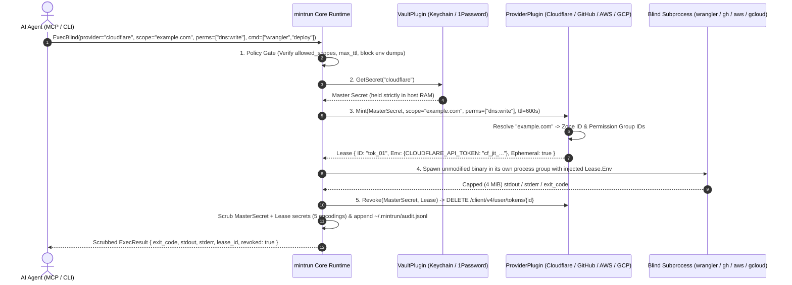

<div align="center">


<br />

# mintrun

### **Authority. Without possession.**

The zero-knowledge Just-In-Time (JIT) credential enclave, blind CLI runner, and MCP server for autonomous AI agents.<br />
Engineered with **100% Go standard library**, **zero external dependencies**, and an **Everything is a Plugin** architecture.

<p align="center">
  <a href="https://github.com/ninja-c9/mintrun/blob/main/go.mod"></a>
  <a href="#architecture-everything-is-a-plugin"></a>
  <a href="#ai-agent-integration-mcp"></a>
  <a href="#verification--testing"></a>
  <a href="LICENSE"></a>
</p>

<p align="center">
  <a href="#why-mintrun">Why mintrun</a> ·
  <a href="#how-it-works">How It Works</a> ·
  <a href="#architecture-everything-is-a-plugin">Architecture</a> ·
  <a href="#quick-start">Quick Start</a> ·
  <a href="#built-for-every-cli">Cloud CLIs</a> ·
  <a href="#ai-agent-integration-mcp">MCP Integration</a> ·
  <a href="#defense-in-depth-security-model">Security &amp; Policy</a> ·
  <a href="#polyglot-plugin-sdk">Plugin SDK</a> ·
  <a href="#roadmap">Roadmap</a>
</p>

</div>

---

## Why mintrun

### **Your vault keeps the master key. Your agent borrows a scoped lease.**

AI coding agents (**Google Antigravity**, **Claude Code**, **Cursor**, **Windsurf**, **Codex**) deploy Cloudflare Workers, open GitHub pull requests, assume AWS roles, and inspect Google Cloud storage.

Yet every existing way of handing credentials to an agent forces a bad trade-off:
- **Plaintext `.env` files & MCP configs** expose long-lived keys directly to the LLM context window and cloud transcripts.
- **Static CLI wrappers (`op run`, `doppler run`, decoy shims)** hide the file on disk, but still inject your full-privilege static token into the child process, miss encoded stdout leaks (Base64, Hex, URL), and offer no scope-down or policy gate.
- **Cloud-locked agent vaults** force you to migrate your secrets out of macOS Keychain or 1Password into a third-party cloud just to run local CLIs.

`mintrun` takes a fundamentally different approach: **Bring Your Own Vault + True JIT Scope-Down + Blind Native CLI Execution.**

| Dimension | Plaintext `.env` / MCP Configs | Static CLI Wrappers (`op run` / Shims) | **The `mintrun` Enclave** |
| :--- | :--- | :--- | :--- |
| **Where master secrets live** | `.env` files, shell profiles, or MCP JSON | Existing vault, or a proprietary cloud vault | **Your existing vault** (`keychain`, `libsecret`, `1password`, or AES-256-GCM local fallback) |
| **What the AI agent sees** | Raw, long-lived API tokens in LLM context | Zero raw tokens, unless echoed in an encoded form | **Zero raw secrets.** The agent requests a provider, a scope, permissions, and a command |
| **What the child CLI receives** | Account-wide permanent credential | Account-wide permanent credential | **Narrowly scoped JIT sub-token** locked to 1 zone, 1 repo, 1 IAM role ARN, or specific OAuth2 scopes |
| **Token lifetime** | Weeks, months, or never rotated | Weeks, months, or never rotated | **Seconds to minutes.** Cloudflare & GitHub sub-tokens are deleted (`DELETE`) the instant the command exits; AWS STS & GCP tokens cannot be revoked early and expire on their own (AWS ≥ 15 min, GCP ≤ 1 h) |
| **Stdout / Stderr scrubbing** | None | Exact raw string match only | **5-Encoding Scrubber** redacts Raw, Base64, RawBase64, Hex, and URL-encoded forms with `[MINTRUN:REDACTED]` |
| **Exfiltration & policy gate** | None | None | **Fail-closed `policy.json`** blocks `env`/`printenv`, restricts scopes/permissions, isolates child env, and can ask a human first (the mintrun macOS app or a dialog, Telegram, or Slack) |
| **Supply-chain footprint** | N/A | Dozens to hundreds of external packages | **0 external dependencies.** 100% Go 1.24 standard library |

> **Design Principle — Separate Authority from Possession:**
> An AI agent never needs to *possess* your Cloudflare token, GitHub App key, AWS secret key, or GCP service-account JSON to run `wrangler`, `gh`, `aws`, or `gcloud`. Your unmodified native CLIs already read standard environment variables—`mintrun` simply mints a disposable credential in memory, runs the binary blindly, scrubs the output, and revokes the lease on exit.

---

## How It Works

<div align="center">
  
</div>

Every time you—or an AI agent over MCP—invoke `mintrun exec`, the runtime executes a deterministic five-stage pipeline:



Stage 5 reports revocation honestly. **Cloudflare** and **GitHub** delete the sub-token immediately over the API, so `revoked: true`. **AWS STS** and **Google Cloud** service-account tokens cannot be invalidated early server-side, so the result reports `revoked: false` and the credentials live until their expiry.

---

## Architecture (`Everything is a Plugin`)

<div align="center">
  
</div>

`mintrun` is built around a tiny, zero-dependency Go kernel (`internal/core`) where secret storage, credential minting, and agent transport are pluggable contracts:

| Plugin Kind | Go Interface | Responsibility | Built-in Implementations |
| :--- | :--- | :--- | :--- |
| **`vault`** | `core.VaultPlugin` | Stores and retrieves long-lived master credentials outside agent context | • **`keychain`** — macOS Keychain (`/usr/bin/security -i`) or Linux libsecret (`secret-tool`), with the secret passed on `stdin` only, never `argv` (a macOS secret too long for one `security -i` line is split across up to 16 Keychain items behind a checksummed header, up to 24,000 bytes), plus an **AES-256-GCM** encrypted `0600` local fallback (`~/.mintrun/vault.json`); the fallback requires a **`MINTRUN_VAULT_KEY`** passphrase (PBKDF2-HMAC-SHA256 key, per-vault random salt), and a failing keystore call prints a warning before it is used. See [what the vault protects](#5-what-the-vault-protects-and-what-it-does-not)<br />• **`1password`** — 1Password CLI (`op`) vault (`op://` URIs & `mintrun:<provider>` items); `secret set` pipes a JSON item template to `op item create` on `stdin` and archives older items with the same title |
| **`provider`** | `core.ProviderPlugin` | Mints short-lived, resource-scoped sub-tokens from a master secret and revokes them on exit where the API allows it | • **`cloudflare`** — Resolves domain names to Zone IDs, maps permissions (`dns:write`, `workers:write`), mints via `POST /client/v4/user/tokens`, and revokes via `DELETE /client/v4/user/tokens/{id}`<br />• **`github`** — Signs RS256 App JWTs (PKCS#1/PKCS#8), mints repo-scoped Installation Tokens (`GITHUB_TOKEN`, `GH_TOKEN`), and revokes via `DELETE /installation/token`<br />• **`aws`** — 100% stdlib SigV4 `STS AssumeRole` JIT minter for the role ARN given as the scope (`arn:aws:iam::<account_id>:role/<name>`), with inline session policy narrowing (`AWS_ACCESS_KEY_ID`, `AWS_SECRET_ACCESS_KEY`, `AWS_SESSION_TOKEN`); a session token in the master secret is signed with the request. STS credentials cannot be revoked early, so leases report `revoked: false` and live until their expiry, at least 15 min (the STS minimum duration)<br />• **`gcp`** — Signs an RS256 JWT bearer assertion (RFC 7523) from a service-account JSON key, exchanges it for an OAuth2 access token limited to the requested scopes (`cloud-platform.read-only`, `devstorage.read_only`, …), and injects `CLOUDSDK_AUTH_ACCESS_TOKEN` + `GOOGLE_OAUTH_ACCESS_TOKEN`. Revocation on exit is best-effort: Google does not revoke service-account tokens server-side, so they live until their fixed ≤1h expiry |
| **`bridge`** | `core.BridgePlugin` | Exposes `mintrun` capabilities to external AI agent harnesses | • **`mcp`** — Full Model Context Protocol (JSON-RPC 2.0 over `stdio`) server exposing `mintrun_exec`, `mintrun_plugins`, and the read-only governance tools `mintrun_policy_check` and `mintrun_audit` |

### Repository Layout

```text
mintrun/
├── cmd/mintrun/
│   ├── main.go                           # CLI entrypoint (exec, secret, plugin, mcp, audit, init, doctor, shim, apps, relay, watch), settings.json
│   ├── setup.go                          # Guided onboarding (mintrun init) and read-only diagnostics (mintrun doctor)
│   ├── shim.go                           # PATH shims (mintrun shim): block-and-redirect or transparent auto-wrap
│   ├── apps.go                           # Non-interactive MCP entries for Claude Code, Claude Desktop & Cursor (mintrun apps), JSON output
│   ├── relay.go                          # Team relay CLI subcommands (mintrun relay serve, device add|remove|list)
│   ├── watch.go                          # Built-in app.sock controller & token-guarded loopback dashboard (mintrun watch)
│   ├── main_test.go                      # End-to-end CLI & subcommand test suite
│   ├── setup_test.go                     # Hermetic init and doctor test suite
│   ├── shim_test.go                      # Hermetic CLI shim (block, auto, env-tightening, shell profiles, doctor) test suite
│   ├── apps_test.go                      # Hermetic mintrun apps test suite (stub claude, byte-exact config edits)
│   └── examples_test.go                  # Installs and runs the example plugins against stand-ins
├── internal/
│   ├── core/
│   │   ├── plugin.go                     # Plugin ABI, Registry, SHA-256 pinning & ExternalPlugin SDK
│   │   ├── runner.go                     # ExecBlind lifecycle, Policy Engine, 5-Encoding Scrubber, Output Cap, TailAudit
│   │   ├── procgroup_*.go                # Process-group kill on timeout/cancel (Unix; no-op elsewhere)
│   │   ├── sandbox_*.go                  # Linux user+mount namespace + seccomp-bpf sandbox helper (no-op elsewhere)
│   │   ├── core_test.go                  # Core JIT mint, scrub, revoke, policy & MCP test suite
│   │   ├── sandbox_linux_test.go         # Linux namespace, tmpfs, capability-drop & seccomp-bpf test suite
│   │   └── sandbox_integration_test.go   # Real macOS sandbox-exec and Linux namespace/libsecret checks (`-tags integration` only)
│   └── builtin/
│       ├── keychain.go                   # macOS Keychain / Linux libsecret + AES-256-GCM fallback & 1Password vault
│       ├── cloudflare.go                 # Built-in Cloudflare, GitHub (RS256 JWT), AWS STS (SigV4) & GCP (JWT bearer) providers
│       ├── mcp.go                        # MCP JSON-RPC 2.0 stdio bridge server
│       ├── telegram.go                   # Telegram approval channel (Bot API long polling)
│       ├── slack.go                      # Slack approval channel (polls a DM's reactions)
│       ├── appbroker.go                  # mintrun macOS app channel over ~/.mintrun/app.sock (approval & stop)
│       ├── relay.go                      # TLS 1.3 SPKI-pinned team relay server & client, per-device rate limit & lease cap
│       ├── watch.go                      # Built-in app.sock v1 server & token-guarded loopback dashboard
│       ├── builtin_test.go               # Comprehensive provider, vault, and MCP unit test suite
│       ├── telegram_test.go              # Telegram approval against a local Bot API
│       ├── slack_test.go                 # Slack approval against a local Web API
│       ├── appbroker_test.go             # App approval and tracking against a local socket
│       ├── relay_test.go                 # Team relay TLS 1.3 SPKI pin, device auth, rate-limit, lease-cap & e2e tests
│       ├── watch_test.go                 # WatchServer app.sock, loopback Host & dashboard token guard tests
│       └── keychain_integration_test.go  # Real macOS Keychain round trip (`-tags integration` only)
├── macos/                                # Native macOS Swift NSStatusBar Menu Bar companion for ~/.mintrun/app.sock
│   ├── MintrunMenuBar.swift              # Single-file AppKit menu bar controller (approvals, active leases, pause, AI apps)
│   ├── build.sh                          # Compiles macos/MintrunMenuBar with swiftc
│   └── README.md                         # Build and usage instructions for the macOS Menu Bar companion
├── examples/plugins/                     # Plugins built into the binary (`plugin install <name>`): bitwarden (vault), vercel & postgres-jit (providers)
├── scripts/
│   ├── release.sh                        # Release archives for macOS and Linux (arm64, amd64) with SHA256SUMS, unsigned
│   └── verify.sh                         # Every acceptance check: gofmt, go vet, tests with a coverage gate above 90%, build & smoke test
└── docs/
    ├── assets/                           # SVG architectural diagrams
    ├── threat-model.md                   # What mintrun promises, the tests behind each promise, and its limits
    └── video/                            # Self-contained HTML/MP4 motion overview & storyboard
```

---

## Quick Start

### 1. Install `mintrun`

```bash
# Install directly with Go 1.24+:
go install github.com/ninja-c9/mintrun/cmd/mintrun@latest

# Or clone and build a reproducible binary from source:
git clone https://github.com/ninja-c9/mintrun.git
cd mintrun
go build -trimpath -o mintrun ./cmd/mintrun

# Print the version, Go version, and platform:
./mintrun -version
```

### 2. Set Up With `mintrun init`

`mintrun init` walks through the setup one step at a time and asks before each: a master secret for GitHub, AWS, Google Cloud, or Cloudflare, approval through Telegram or Slack, a starting policy, and the MCP entry in your IDEs. `mintrun doctor` then checks what is in place.

```bash
./mintrun init              # every step, each after a yes
./mintrun init github       # one step: github, aws, gcp, cloudflare, telegram, slack, policy, or mcp
./mintrun doctor            # check the setup; exits 1 if any check fails
```

- **Checked before it is stored.** A GitHub App ID and installation ID must be digits, and the App's private key must parse; leave the installation ID empty and each request picks one, which `init` tells you to limit with `allowed_installations`. An AWS access key ID must look like `AKIA…` or `ASIA…`, and an `ASIA` key needs its session token. A Google Cloud key file needs a `client_email` and a `private_key` that parses. Tokens and secret keys are typed with echo off, private keys and key files are read from their path, and a stored secret is replaced only after a yes.
- **A policy that starts closed.** `init policy` suggests a rule for one repository, taken from the current directory's `origin` remote (the remote URL, which can hold a token, is never printed), with `clean_env` on, `sandbox` on when this host can run the sandbox (`Runtime.SandboxReady()` checks the same resolver `exec` runs; when it is ready `init` prints a note that keystore/D-Bus logins fail inside and the network stays open, and when it is not ready `init` prints `Sandbox: not suggested: <cause>` with no path and omits `sandbox`), and `allow_static` off. It writes `policy.json` only after a yes and only when there is none: an existing one is never changed, and `init` prints the rule to add to it instead.
- **Each IDE its own way.** `init mcp` adds Claude Code with `claude mcp add -s user`, shows Cursor's install link (and opens it on macOS after a yes), and edits Claude Desktop's or Antigravity's config only after a yes, keeping a timestamped backup and every other entry. The entry runs this binary by its absolute path and carries no environment, so `MINTRUN_VAULT_KEY` never lands in a config. With the encrypted file vault, an IDE started from the Dock or an app launcher may not get your shell's `MINTRUN_VAULT_KEY`: start it from that shell, or use the macOS Keychain or libsecret, which need no passphrase.
- **`doctor` only reads.** It reports the binary and whether `PATH` runs it, the vault and which providers have a master secret, the approval settings, `policy.json` (including a field `exec` would ignore, such as a misspelling), and each IDE's `mintrun` entry. It prints names, never a secret, its length, or an IDE config's contents, and calls no cloud or chat API.

### 3. Or Enroll a Master Secret by Hand

Store your master credential in the OS keystore yourself. `mintrun` never modifies or replaces your existing cloud CLIs—it injects ephemeral credentials at runtime.

```bash
# Prompts on stdin with terminal echo off, so your master secret never appears
# on screen, in shell history, or in `ps`:
./mintrun secret set cloudflare

# Verify existence without ever printing the secret value:
./mintrun secret check cloudflare
# -> Secret "cloudflare" is configured in vault "keychain" (value hidden).
# A missing secret prints the command that stores it, and a vault that cannot be read
# (such as a wrong MINTRUN_VAULT_KEY) says so with the vault's error. Both exit 1.

# Piped or redirected input is read whole, so multi-line secrets such as a GCP
# service-account JSON key or a GitHub App PEM survive intact (and stay off argv):
./mintrun secret set gcp < sa-key.json
```

`mintrun secret set <provider> <secret>` still works, but prints a warning: an argument is visible in shell history and `ps`. On macOS, a secret too long for one `security -i` line (about 2 KB, such as a GCP service-account JSON or a GitHub App PEM) is split across up to 16 Keychain items, 24,000 bytes in all; a longer one is stored in the encrypted file vault with a warning, and that needs `MINTRUN_VAULT_KEY` set.

`mintrun` reads the Keychain or libsecret before the encrypted file vault, so `secret set` removes the older copy from the other store: a keystore store removes the file-vault copy (without `MINTRUN_VAULT_KEY` it cannot decrypt `vault.json`, so it warns that the copy may remain), and a store that falls back to the file vault removes the keystore item. If the keystore exists but cannot be reached (for example, `secret-tool` without a D-Bus session), that removal can fail too, and `secret set` then exits non-zero after storing the secret in the file vault. On such a host, set `MINTRUN_FILE_VAULT=1` wherever `mintrun` runs (your shell and the MCP server config) to use only the encrypted file vault.

### 4. Settings (`~/.mintrun/settings.json`)

The mintrun macOS app keeps two settings in `~/.mintrun/settings.json`, and you can write the file yourself:

```json
{ "vault": "keychain", "approval_timeout_seconds": 300 }
```

- **`vault`** picks where master secrets live: `keychain` (the macOS Keychain or Linux libsecret, then the encrypted file vault; the default), `1password`, or `file` (the encrypted file vault only, like `MINTRUN_FILE_VAULT=1`). A non-empty `MINTRUN_VAULT`, or `MINTRUN_FILE_VAULT=1`, wins over it. Switching moves no secrets: store each one again in the new vault.
- **`approval_timeout_seconds`** (1 to 600, default 600) is how long [approval](#approve-from-your-phone-telegram-or-slack) waits before the request is not approved.
- **Read once, at start.** A running `mintrun mcp` keeps the old values until its AI app restarts it.
- **Checked.** Unknown keys are ignored. Any other value for a known key, malformed JSON, or a file that exists but cannot be read stops `mintrun` with an error that names the cause, never the file's path. Only a missing file means no settings.

---

## Built for Every CLI

`mintrun` wraps your unmodified native binaries (`wrangler`, `gh`, `aws`, `gcloud`, `terraform`, `curl`) and injects standard environment variables into the blind child process.

### Cloudflare (`wrangler`)
Create a Cloudflare API Token with **`User -> API Tokens -> Edit`** so `mintrun` can mint and revoke disposable child tokens on your behalf:

```bash
# Mint a sub-token locked ONLY to `example.com` with DNS + Workers write access,
# run Wrangler, scrub stdout/stderr, and DELETE the sub-token when Wrangler exits:
./mintrun exec \
  -provider cloudflare \
  -scope example.com \
  -perms dns:write,workers:write \
  -ttl 300 \
  -- npx wrangler deploy
```

### GitHub CLI (`gh` & `git`)
Store a GitHub App credential formatted as `<app_id>:<installation_id>:<private_key_pem>` (or `<app_id>::<private_key_pem>` when MCP agents select an installation via `params.installation_id`):

```bash
# Enroll your GitHub App credential via stdin:
printf '%s:%s:%s' "123456" "87654321" "$(cat app-private-key.pem)" | ./mintrun secret set github

# Mint a repository-scoped installation token, run `gh`, and revoke it on exit:
./mintrun exec \
  -provider github \
  -scope ninja-c9/mintrun \
  -perms contents:write,pull_requests:write \
  -- gh pr create --fill
```

### AWS CLI (`aws` & `terraform`)
Store IAM credentials formatted as `<access_key_id>:<secret_access_key>[:<session_token>]`. `mintrun` signs an `STS AssumeRole` request with 100% stdlib SigV4 and narrows the session with an inline IAM policy:

```bash
./mintrun exec \
  -provider aws \
  -scope arn:aws:iam::123456789012:role/DeployRole \
  -perms s3:GetObject,s3:PutObject \
  -ttl 900 \
  -- aws s3 ls s3://my-Bucket
```

### Google Cloud SDK (`gcloud` & `gsutil`)
Permissions map to OAuth2 scopes (short names expand under `https://www.googleapis.com/auth/`). Add `-clean-env` so the child only sees `PATH`, `HOME`, `TMPDIR`, `USER`, `LANG`, `TERM`, `SSL_CERT_FILE`, your policy's `allowed_env`, and the lease credential:

```bash
./mintrun exec \
  -provider gcp \
  -perms cloud-platform.read-only \
  -clean-env \
  -- gcloud storage ls gs://my-bucket
```

> **Explicit Static Wrapper Mode:** Already have a pre-scoped token (such as a Cloudflare scoped token, a GitHub PAT, stored AWS IAM keys, or a GCP OAuth2 access token) and only want zero-knowledge injection + 5-encoding output scrubbing? Request static mode explicitly with `-perms static` (MCP: `"permissions": ["static"]`). Because static mode hands the stored secret directly to the child without minting a disposable token, the provider must also opt in with `"allow_static": true` in `policy.json`:
> ```bash
> ./mintrun exec -provider github -perms static -- gh issue list -R ninja-c9/mintrun
> ```
> ```json
> { "github": { "allow_static": true } }
> ```
> Static mode never wraps a private key the provider signs with: `github` refuses a GitHub App private key and `gcp` refuses a service-account JSON or PEM key.
>
> **Migration (breaking change):** `github` used to fall back to static mode for a PAT, and `aws` for any scope that is not an `arn:aws:` role ARN, which skipped the `allow_static` gate. Both now fail with an error that names the opt-in. To keep injecting a GitHub PAT or stored IAM keys, add `-perms static` and `"allow_static": true` for `github` or `aws`. GitHub App credentials and AWS role-ARN scopes mint JIT credentials as before.

### Intercept Direct CLI Calls (`mintrun shim`: Block & Redirect or Auto-Wrap)

Coding agents often default to running `gh`, `aws`, `gcloud`, `wrangler`, `vercel`, or `psql` directly in bash instead of calling `mintrun_exec`. Place `~/.mintrun/shims` ahead of standard binary directories on `PATH` to intercept those calls in either of two modes:

```bash
# 1. Block & Redirect mode (default): refuse direct CLI runs (exit 126) and print
# the exact `mintrun_exec` MCP call + `mintrun exec` command so the agent self-corrects.
# `shim install` then asks before it adds the PATH line to your shell profiles (see below):
./mintrun shim install gh aws gcloud wrangler

# 2. Transparent Auto-Wrap mode: intercept `gh ...` and route it through ExecBlind
# (policy gate -> JIT token mint -> 5-encoding scrub -> instant revoke on exit):
./mintrun shim install -mode auto -scope ninja-c9/mintrun -perms contents:read,pull_requests:write gh

# Inspect or remove shims (`mintrun doctor` also checks shim symlinks and PATH order):
./mintrun shim list
./mintrun shim remove gh
```

- **Mode 1 (`block`, default):** Exits `126` before opening any vault or spawning the binary, and prints a redirect message naming both the `mintrun_exec` MCP tool and the exact `mintrun exec -provider <provider> -scope <scope> -perms <perms> -- <tool> ...` command.
- **Mode 2 (`auto`):** Resolves the real binary on `PATH` (skipping `~/.mintrun/shims` and rejecting relative `PATH` entries), determines the target scope and permissions (from `shims/config.json`, `-R`/`--repo` or `git remote get-url origin` for `gh` without printing the remote URL, or a single concrete rule in `policy.json`), and runs the command through `ExecBlind`.
- **Environment tightening only:** Setting `MINTRUN_SHIM_MODE=block` forces even an `auto` shim into `block` mode for an agent subshell, whereas `MINTRUN_SHIM_MODE=auto` never loosens a `block` shim.
- **Shell profiles change only after you say yes:** `shim install` shows one line, `export PATH='<home>/shims':"$PATH" # mintrun-shim`, and the profiles it would go last in: `~/.zshenv` and `~/.zshrc` (created if missing), plus `~/.zprofile` and `~/.bashrc` if they exist. It goes last because Homebrew's line in `~/.zprofile` puts its own directory first. Then it asks `[y/N]`. Any answer but `y` or `yes` (Enter and EOF included) changes nothing, so you can add the line yourself. On a yes, each existing profile is first copied to `<file>.bak-<YYYYMMDD-HHMMSS>` with the same permissions. A profile that is a symlink (from a dotfiles repo, say) is edited where it points; a broken link is left alone. A profile that changed while the question was open is left unchanged, and `mintrun` stops and asks you to run the command again. Ctrl-C at the question stops `mintrun`. Open a new shell to use the shims. Once no shim is left, `shim remove` asks the same way and takes out only that exact line, so a line of your own that mentions `# mintrun-shim` stays. When the line already comes last in each profile, nothing is asked; `shim install` prints the `export` line if the current shell's `PATH` does not put the shims first.

### Inspect the Zero-Secret Audit Trail

Every request gets exactly one entry in `~/.mintrun/audit.jsonl`, a blocked or failed one too. It records the request's `task` handle, where it came from (`via`: `cli` for `mintrun exec` and the shims, `mcp` for an agent), lease metadata (`expires_at` for a lease that expires), exit code, revocation status, `truncated` when an output stream hit the 4 MiB cap, and how it ended:

- `outcome`: `done` (exit code 0), `blocked` (the policy gate refused it, and `blocked_by` names the check: `invalid_request`, `paused`, `purpose`, `policy_file`, `env_dump`, `static`, `scope`, `permission`, `installation`, `command`, or `sandbox`), `denied` (a human said no), `no_answer` (nobody answered by the approval deadline), `failed` (a non-zero exit, or every approval channel, the vault, or the provider failed), `stopped` (stopped from the mintrun app), `interrupted` (`mintrun` got a signal, or the MCP server shut down), or `timed_out` (the 5-minute limit).
- `decided_at`: when a human answered the approval.
- `sandbox: true` marks a request the gate let through, or asked a human about, with the sandbox on (and `no_network: true` when network egress was blocked too); one it blocked before that has none, and MCP `mintrun_audit` shows both fields as they are.
- An agent's request also records the AI app's name as `client` and the agent's `purpose`. Both are what the agent claims, never an identity.

Secrets the runner holds (master secret, lease credentials) are scrubbed. A policy-denied entry keeps its raw command because no secret is loaded yet, so never put a secret in `argv`; MCP `mintrun_audit` shows agents each entry's verdict but no text an agent wrote. `mintrun audit` and `mintrun_audit` read the file through `core.TailAudit` (seeking backward from the end of the file in 64 KiB chunks when `-limit > 0`, so it stops reading once it has the last `limit` matches instead of scanning a multi-megabyte log from the start):

```bash
./mintrun audit -provider cloudflare -limit 5
```
```json
{"ts":"2026-10-17T04:20:00Z","task":"EXAMPLETASKHANDLE234567ABC","via":"cli","provider":"cloudflare","scope":"example.com","permissions":["dns:write","workers:write"],"command":["npx","wrangler","deploy"],"outcome":"done","lease_id":"9a8b7c6d5e","ephemeral":true,"expires_at":"2026-10-17T04:30:00Z","revoked":true,"exit_code":0,"duration_ms":1840}
```

---

## AI Agent Integration (MCP)

Connect `mintrun` to **Google Antigravity**, **Claude Code**, **Cursor**, or **Windsurf** so your agent can execute authenticated CLI workflows without ever seeing raw credentials:

```json
{
  "mcpServers": {
    "mintrun": {
      "command": "/path/to/mintrun",
      "args": ["mcp"]
    }
  }
}
```

`mintrun init mcp` adds this entry for you (see [Quick Start](#quick-start)). Set `command` to the absolute path of a built binary, not a `go run` build, whose temporary binary is deleted when it exits, and give the entry no `env`: a `MINTRUN_VAULT_KEY` there lets anyone who can read the config decrypt the vault.

### Connect AI Apps With `mintrun apps`

`mintrun apps` adds, checks, or removes the same entry for Claude Code, Claude Desktop, and Cursor without asking, and prints one JSON row per app. The mintrun macOS app runs it this way:

```bash
./mintrun apps status
./mintrun apps connect -dry-run
./mintrun apps connect -app claude-desktop,cursor
./mintrun apps disconnect -app cursor
```

- **Unlike `init mcp`**, it never asks, updates an entry that runs another command, and writes Cursor's `~/.cursor/mcp.json` instead of opening its install link. Without `-app`, `connect` and `disconnect` skip an app that is not found (no `claude` on `PATH`, or no config folder). `status` reports each app's `found`, `installed`, and `matches` (the entry runs this binary with `mcp`); `connect` and `disconnect` report `add`, `update`, `remove`, or `none`, and `-dry-run` reports without changing anything. A row with an `error` makes it exit 1.
- **Claude Code** changes only through its own CLI (`claude mcp add` and `claude mcp remove`, user scope), found on `PATH`, and `init mcp`, `doctor`, and `apps` read `<CLAUDE_CONFIG_DIR>/.claude.json` when `CLAUDE_CONFIG_DIR` is an absolute path (surrounding space trimmed; a relative one is ignored in favor of `~/.claude.json`). An entry that also sets keys besides `type`, `command`, `args`, and an empty `env` is left alone, with an error that names those keys, never their values.
- **Claude Desktop and Cursor** get only the `mintrun` entry under `mcpServers` edited; every other byte of the file stays as it was, and connect then disconnect restores the original file when it already listed another server. A file that is not valid JSON, whose `mcpServers` or `mintrun` is not an object, or that repeats either key is refused. A config is created only when the app's own folder exists. A symlinked config is edited where it points, a broken link is refused, and a file that changed during the edit is left alone. The write is atomic and keeps the file's mode (`0600` for a new file).
- **The entry** runs this binary by its absolute path with `args: ["mcp"]`, and a new one has no `env`. Updating a Claude Desktop or Cursor entry rewrites only its `command` and `args`, so its other keys, an `env` included, stay. `-command` names another absolute path to an executable. A `go run` build is refused. The output names the command only, never an entry's args or env, or anything else in a config.
- **Tested against stand-ins and read-only on this host.** `go test` runs it against a stub `claude` and throwaway config files, and `mintrun doctor`, `mintrun apps status`, and `mintrun apps connect -dry-run` have also been run read-only against real Claude Code, Claude Desktop, Cursor, and Antigravity installs on macOS 27.0.

### Exposed MCP Tools

| Tool Name | Description | Key Parameters |
| :--- | :--- | :--- |
| **`mintrun_exec`** | Mints a scoped JIT credential, runs the target CLI command in a blind subprocess, scrubs all secret strings from `stdout`/`stderr`, and revokes the credential before returning where the provider allows it (AWS STS and GCP credentials can only expire; `revoked` reports which). Each output stream is capped at 4 MiB; `truncated: true` marks a cut. The command is killed after 5 minutes. | `provider` (`"cloudflare"`), `scope` (`"example.com"`), `permissions` (`["dns:write","workers:write"]`), `command` (`["wrangler","deploy"]`), `cwd`, `ttl_seconds`, `clean_env`, `sandbox` (`true` runs the command in the [macOS or Linux sandbox](#1-declarative-policy-guardrails-mintrunpolicyjson)), `no_network` (`true` also blocks network egress inside the sandbox, and turns `sandbox` on), `params` (`{"installation_id":"12345678"}` picks a `github` App installation), `approve` (`true` asks a human first), `purpose` (why, in one line of at most 300 bytes, shown to the approver as the agent's claim) |
| **`mintrun_plugins`** | Lists all registered built-in and external plugins (`vault`, `provider`, `bridge`) along with their supported permission scopes. | *(none)* |
| **`mintrun_policy_check`** | Dry-runs a `mintrun_exec` request against `policy.json` and the anti-exfiltration guard, through the same gate `mintrun_exec` enforces. Never opens the vault, mints, runs the command, or asks a human. Returns `allowed`, the denial `reason` (the exact error `mintrun_exec` would return), `approval_required`, `ttl_seconds` (the TTL requested from the provider after `max_ttl_seconds`; `gcp` tokens always live up to 1h), `clean_env`, `sandbox`, and `no_network`. | Same as `mintrun_exec` |
| **`mintrun_audit`** | Returns recent audit entries, oldest first, filtered like `mintrun audit`. Each entry keeps its verdict (`outcome`, `blocked_by`, `exit_code`), `task`, `via`, `client`, `lease_id`, and timestamps, but no text an agent wrote: `scope`, `permissions`, and `purpose` are blank, an `error` reads `[MINTRUN:REDACTED]`, and each command is cut to its binary name plus `[MINTRUN:REDACTED]`. A policy-denied entry keeps the raw `argv` (no secret is loaded yet to scrub against), and a secret typed into `argv` is one the runner never holds, so arguments never reach an agent. The on-disk log keeps every field for the operator. | `provider` (case-insensitive), `failed_only`, `limit` (default 20, max 100) |

The vault is yours to pick, never the agent's: `mintrun mcp` reads every master secret from the vault it was started with (`MINTRUN_VAULT`, or `keychain`). A `mintrun_exec` or `mintrun_policy_check` request that names a vault (`vault`), even that same one, is denied with the same reason by both, and the denied `mintrun_exec` goes to the audit log like any other denial. Nor does an agent set the time limit: its command is killed after 5 minutes, like one run with `mintrun exec`, and a request that sets `timeout_seconds` is denied the same way.

### Approve From Your Phone (Telegram or Slack)

`mintrun exec -approve`, `MINTRUN_APPROVE=1` in `mintrun`'s environment, and `"require_approval": true` in a provider's policy ask a human before anything is minted; the last two also cover an agent's `mintrun_exec` calls. An agent can ask for this check itself with `approve: true`, but cannot turn off one that `MINTRUN_APPROVE=1` or the policy requires. On macOS, the mintrun app asks when it is running, and a dialog asks when it is not; Deny is the dialog's default button, so pressing Return denies. With a Telegram or Slack bot set up (or both), your phone is asked at the same time, so you can approve an agent's commands away from the machine. The first answer, from any of them, wins and closes the others.

**The mintrun macOS app & `mintrun watch`.** `mintrun` first tries the app's socket, `~/.mintrun/app.sock`, and shows the dialog only when nothing listens there. Once it has reached the app, a dropped connection or a malformed reply fails that channel, never approves, and brings up no dialog; Telegram and Slack still race it. In the `approve` request, `mintrun` always sends `"sandbox": true` or `"sandbox": false` and `"no_network": true` or `"no_network": false` (the verdict's sandbox and network flags), so the app card shows whether the sandbox is on and whether the network is blocked, and can tell `false` from an older `mintrun` that sends neither key. For each running command, `AppTrack` opens a second connection and sends `{"v":1,"type":"started","entry":…}` (where `entry` is an `AuditEntry`, so a missing `sandbox` or `no_network` key there means `false`) and keeps the connection open until the final audit entry is written: clicking **Stop** in the app sends `{"type":"stop"}\n` on that connection, which kills the command's process group and records `outcome: stopped`, and a connection that closes before a final audit entry appears for its `task` means `mintrun` died while the command was running. Any program running as you can listen on that socket and answer, but such a program can already edit `policy.json` and read your Keychain (see [5](#5-what-the-vault-protects-and-what-it-does-not)), so the socket adds no isolation. Two companion controllers ship in this repository:
- **`mintrun watch [-http 127.0.0.1:0]`** — built into the single Go binary: binds `~/.mintrun/app.sock` (`0600`, refusing a non-socket or a live socket already bound by another watcher) and serves a loopback-only web dashboard whose printed URL ends in a `#token`: the browser keeps the token in the fragment and never sends it, so `GET /` needs no credential while every `/api/` request must carry the token in `X-Mintrun-Token` and name a loopback address in `Host` (a host such as `dashboard.example.com` is refused), and `POST /api/decide`, `/api/stop`, and `/api/pause` additionally require `X-Mintrun-Watch: 1`. It shows pending approvals, active leases with a **Stop** button, global Pause/Resume (`~/.mintrun/paused`), and recent audit entries.
- **[`macos/MintrunMenuBar.swift`](macos/README.md)** (`./macos/build.sh && ./macos/MintrunMenuBar`) — native macOS `NSStatusBar` Menu Bar companion implementing the same `~/.mintrun/app.sock` v1 contract (`NSAlert` approval modal with Deny as the default button, active leases with **Stop**, Pause/Resume toggle, and AI app connection management via `mintrun apps`). The app connects with the same `http://127.0.0.1:<port>/#<token>` URL `mintrun watch` prints (or `MINTRUN_WATCH_URL`), refuses a URL without the `#token` fragment, and sends the token in `X-Mintrun-Token`, never in a request URL.

**Telegram:**

1. Create a bot for `mintrun` alone with [@BotFather](https://t.me/BotFather).
2. Run `mintrun init telegram` and paste the bot token (echo is off). On the phone that will approve, open the link it shows and tap **Start**, then confirm the name it read. It stores your user ID and the token in the default vault and sends a test request: answer it either way. Only a `/start` that carries the link's one-time code counts, so a message to the bot from anyone else is ignored.

To store the setting by hand instead, send the bot `/start` from your account, then enter your numeric Telegram user ID (not your @username) and the bot token:

```bash
mintrun secret set approval-telegram    # enter <user_id>:<bot_token>
```

**Slack:**

1. Create an app for `mintrun` alone at [api.slack.com/apps](https://api.slack.com/apps), give its bot the `chat:write`, `reactions:read`, and `reactions:write` scopes, and install it to your workspace.
2. Run `mintrun init slack`, paste the bot token (`xoxb-…`, echo is off), and enter your Slack member ID (`U…`, from **Copy member ID** in your profile's menu). It stores both in the default vault and sends you a test request: answer it either way. Slack has no link to prove the member ID is yours, so `init` then asks whether you answered it, and removes the setting if someone else did.

To store the setting by hand instead:

```bash
mintrun secret set approval-slack       # enter <user_id>:<bot_token>
```

The bot sends you a direct message with ✅ and ❌ already on it: tap one. `mintrun` polls the message's reactions, so it needs no public URL.

- **Only your answer to this request counts.** A tap or reaction from another account, or on another request's message, is ignored, and so are the Slack bot's own reactions and any emoji but ✅ and ❌. In Slack, ❌ wins if you add both. The message is then edited to show the outcome: allowed, denied, expired (no answer by the approval deadline), or closed (another channel answered first, or the request was canceled).
- **Ten minutes, then no.** Every channel, the app and the macOS dialog included, stops at the approval deadline: 10 minutes, or `approval_timeout_seconds` in [`settings.json`](#4-settings-mintrunsettingsjson) (1 to 600). The request is then not approved (`outcome: no_answer`), and the dialog's `osascript` is stopped, so the dialog closes. On Linux, where there is no dialog, `mintrun watch`, Telegram, and Slack are the approval channels. With none, `-approve` fails closed.
- **A Telegram bot of its own.** `mintrun` reads taps with `getUpdates`, which Telegram refuses while the bot has a webhook.
- **Slack polls.** `mintrun` reads the message's reactions every 3 seconds, so an answer takes a few seconds to land, and each waiting request spends about 20 `reactions.get` calls a minute of the app's Tier 3 limit (50 or more a minute). When Slack rate-limits it, it waits as long as `Retry-After` says. A missing scope, a revoked token, or any other refusal ends the Slack request with that error, never an approval.
- **The default vault only.** The settings are read from the default vault (`MINTRUN_VAULT`, or `keychain`), never from the vault a request names, so an agent cannot send approvals to a bot it controls.
- **The sandbox and network first.** The first two lines under the heading are `Sandbox: on` or `Sandbox: off` and `Network: blocked` or `Network: open`, which `mintrun` writes itself, unquoted, ahead of every field an agent sets, so a long request cannot push them behind the TRUNCATED warning. They show the policy's decision, not only the request's: a rule that turns the sandbox or `no_network` on for a provider reads `on` or `blocked` even when the request did not ask for it, and `no_network` turns the sandbox on too. A rule saved while you decide can still add either, never remove them.
- **Hints, advice only.** Right under `Network:`, or under `Device:` on a relay server, comes `Hints: none` or the labels `mintrun` reads off the command's arguments, in this order: `delete` (an argument that is `delete`, `rm`, `remove`, `destroy`, `purge`, or `truncate`, or starts with `drop `, `delete `, or `truncate `, so `-X DELETE` counts), `force` (`--force`, `--force-with-lease`, `--hard`, `--no-verify`, `--yes`, `-rf`, or `-fr`, but not a bare `-f`, which `gh api` uses to set a field), `network-tool` (`curl`, `wget`, `nc`, `ncat`, `ssh`, `scp`, or `rsync`), `encode` (`base64`, `xxd`, `od`, or `hexdump`), `shell` (`sh`, `bash`, `zsh`, `tee`, or `eval`, or an argument holding `|`, `>`, `$(`, or a backtick), and `external-url` (an `http://` or `https://` URL whose host is not the provider's own, such as `github.com` or a subdomain of it for `github`; for a provider with no hosts of its own, any URL). Like the sandbox and network lines, it is unquoted and ahead of every agent field, so a long request cannot push it behind the TRUNCATED warning. Only the command and the provider are read, never the purpose, params, or working directory, and each argument is matched whole in any letter case: `rm` and `RM` count, `/bin/rm` and `--method=DELETE` do not. The labels decide nothing, and `Hints: none` does not mean a command is safe.
- **Every field quoted.** The dialog and the messages show each field of the request in quotes, the vault and the working directory included, so a line break in an argument shows as `\n` and cannot pose as a line of the request. A vault or working directory the request leaves empty shows as `(not set: …)` without quotes: the default vault, or the directory `mintrun` itself runs in. Slack's message also escapes `&`, `<`, and `>`, so an argument cannot mention `@channel` or a person, or hide a link behind other text. A request too long to show ends in a TRUNCATED warning: deny it unless you know the rest.
- **The agent's words, labeled.** An agent's request ends with its `purpose` on a `Purpose:` line and the AI app's name on a `Client:` line, after every fact about the request, so a long request is cut through them first. Both are what the agent claims: any program can send any name and any reason, so judge the command, not the purpose.
- **What Telegram and Slack see.** The message carries whether the sandbox is on and whether the network is blocked, the hints, the provider, vault, scope, permissions, params, command, working directory, and an agent's purpose and AI app name through Telegram's or Slack's servers, and stays in the chat. It holds no secret, because approval comes before any secret is loaded, but a secret typed into the command's arguments would be in it, and a working directory is often a local path that holds your user name.
- **Tested against stand-ins.** Both channels, and `mintrun init`'s link and test request, have run only against a local Bot API and a local Slack Web API in `go test`, never a real Telegram bot or Slack workspace. The app channel is tested against `mintrun watch` and a test socket, and the dialog's deadline against a stub `osascript`.

---

## Defense-in-Depth Security Model

The [threat model](docs/threat-model.md) lists what `mintrun` promises, the tests behind each promise, and where each one stops. To report a vulnerability, see [SECURITY.md](SECURITY.md).

### 1. Declarative Policy Guardrails (`~/.mintrun/policy.json`)

Restrict which domains, repositories, roles, or permissions an AI agent may touch, cap lease TTLs, enforce a minimal child environment, or require human approval (the mintrun app or a macOS dialog, [Telegram, or Slack](#approve-from-your-phone-telegram-or-slack)) per provider in `~/.mintrun/policy.json`:

```json
{
  "cloudflare": {
    "allowed_scopes": ["staging.example.com", "sandbox.example.com"],
    "blocked_commands": ["delete", "r2 bucket delete", "curl"],
    "max_ttl_seconds": 300
  },
  "github": {
    "allowed_scopes": ["ninja-c9/*"],
    "allowed_permissions": ["contents:read", "contents:write", "pull_requests:write", "issues:write"],
    "blocked_commands": ["repo delete", "secret"],
    "max_ttl_seconds": 600
  },
  "gcp": {
    "allowed_permissions": ["cloud-platform.read-only", "devstorage.read_only"],
    "clean_env": true,
    "allowed_env": ["CLOUDSDK_CORE_PROJECT"]
  }
}
```

If `~/.mintrun/policy.json` exists but cannot be read (a directory, a file without read permission, a symlink to a missing file) or is malformed JSON, `mintrun` **fails closed**: it prints a warning and denies every execution until the file is fixed. Only a missing `policy.json` means no policy. `mintrun` reads the file again on every request, so a saved change applies to a running `mintrun mcp` at once.

**Pause:** while `~/.mintrun/paused` exists (the mintrun app's Pause creates it, as does `touch ~/.mintrun/paused`; anything there counts, a dangling symlink too, and removing it resumes), every new request is denied (`blocked_by: paused`) before any secret is loaded, and a request that was waiting for approval is denied once it is approved. Pause blocks new requests only: a command already running and credentials already handed out keep working until they end or expire.

**What an agent can get around:** an agent with its own shell can bypass pause and every rule here. It can run `security` itself, point `MINTRUN_HOME` at another folder (no `policy.json` or pause file there, while the Keychain items stay readable), or delete the pause file. Approval does not stop code already running as you either: it can answer on the app's socket, edit `policy.json`, or delete the pause file. See [5](#5-what-the-vault-protects-and-what-it-does-not).

**Child environment isolation:** `clean_env: true` (or any non-empty `allowed_env`) runs the command with only `PATH`, `HOME`, `TMPDIR`, `USER`, `LANG`, `TERM`, `SSL_CERT_FILE`, the `allowed_env` globs, and the lease env, so ambient host secrets such as `SSH_AUTH_SOCK` or other cloud keys never reach the child. A caller can request the same per run with `-clean-env` (CLI) or `clean_env` (MCP), but cannot switch off a policy that enables it. `MINTRUN_VAULT_KEY` is never passed to a child, even when allowlisted.

**Sandbox (macOS and Linux):** `"sandbox": true` runs every command for that provider inside the OS sandbox. On macOS it uses `/usr/bin/sandbox-exec`, with a profile that denies reads and writes in `mintrun`'s home (`~/.mintrun`: `vault.json`, `policy.json`, `audit.jsonl`) and in your Keychain folder (`~/Library/Keychains`), and denies the system services the Security framework reaches the Keychain through. On Linux it re-executes `mintrun` in new user and mount namespaces (`CLONE_NEWUSER | CLONE_NEWNS`) where `mintrun`'s home and existing keyring directories (`~/.local/share/keyrings`, `$XDG_DATA_HOME/keyrings`, `/run/user/<uid>/keyring`, `$XDG_RUNTIME_DIR/keyring`) are covered with a read-only `mode=000` `tmpfs` and existing D-Bus session bus sockets (`/run/user/<uid>/bus`, `$XDG_RUNTIME_DIR/bus`, and a `unix:path=...` socket in `DBUS_SESSION_BUS_ADDRESS`) are covered with `/dev/null`, then locks `PR_SET_SECUREBITS` (`0x2f`) and drops every capability before `exec`ing the command. Adding `"no_network": true` in `policy.json`, `-no-network` on the CLI, or `no_network: true` in MCP turns the sandbox on too (`no_network` implies `sandbox`) and also blocks network access inside the child: on macOS it adds `(deny network*)` to the `sandbox-exec` profile, and on Linux (`linux/amd64` and `linux/arm64`) the helper unshares a network namespace (`CLONE_NEWNET`, loopback left down) and installs a `seccomp-bpf` filter before `exec` that fails `socket`, `connect`, and `bind` with `EPERM` while leaving `socketpair` open. A caller can ask for `-sandbox` or `-no-network` per run, but cannot switch off a policy that enables either. When the sandbox or `no_network` is on but cannot be set up (another OS, no `sandbox-exec`, a non-filesystem `DBUS_SESSION_BUS_ADDRESS` such as `unix:abstract=...`, a host that blocks unprivileged user, mount, or network namespaces or `seccomp`, an unsupported Linux architecture for `no_network`, or a folder that cannot be resolved), the request is denied before any secret is loaded, never run without it. An approval request says `Sandbox: on` or `Sandbox: off` and `Network: blocked` or `Network: open`, and the audit entry of a sandboxed run carries `sandbox: true` (plus `no_network: true` when network egress was blocked). See [what it blocks and what it does not](#5-what-the-vault-protects-and-what-it-does-not) and [optional network isolation](#6-optional-network-isolation-no_network).

**GitHub App installations:** a credential stored as `<app_id>:<installation_id>:<private_key_pem>` or `<installation_id>:<app_jwt>` pins one installation, and `github` refuses an MCP `params.installation_id` that names a different one before any request reaches GitHub, so a pinned credential needs no policy rule. To let agents pick among several installations, store `<app_id>::<private_key_pem>` (no installation) and list the IDs they may use:

```json
{ "github": { "allowed_installations": ["12345678", "87654321"] } }
```

Once `allowed_installations` is set, every request for that provider must carry a listed `params.installation_id` (exact match, no wildcards), even if the stored credential pins one, and `mintrun_policy_check` reports the same denial. The CLI sends no `params`, so it cannot use a provider with this rule.

### 2. Anti-Exfiltration Command Filter

Even without a custom `policy.json`, `mintrun` automatically blocks trivial environment-dumping commands (`env`, `printenv`, `export`, `/proc/self/environ`) at the policy gate before any secret is unlocked or minted.

### 3. Five-Encoding Output Scrubber

Before `ExecBlind` returns `stdout`, `stderr`, `LeaseID`, or process error messages to the caller or MCP bridge, `core.Scrub()` replaces every occurrence of:
1. The **Master Secret**
2. Every injected **`Lease.Env`** value
3. Any additional provider-specified **`Lease.Redact`** and **`Lease.RevokeSecret`** tokens

across **Raw**, **Base64**, **RawBase64**, **Hex**, and **URL-encoded** representations with `[MINTRUN:REDACTED]`.

### 4. Bounded Output & Process-Group Kill

Each child stream keeps its first 4 MiB; the rest is counted and dropped, so a runaway command cannot exhaust memory. A cut stream ends with `[MINTRUN:TRUNCATED <n> bytes]`, and the result and audit entry carry `truncated: true`. A tail that could be the start of a secret variant is dropped before scrubbing, so the cut never leaves half a secret behind.

On Unix the command runs in its own process group. A timeout (5 minutes), a stop from the mintrun app, or a `SIGINT` / `SIGTERM` / `SIGHUP` to `mintrun` kills the whole group with `SIGKILL`, so no grandchild keeps running with the lease; on other systems only the command's own process is killed. A process that left the group (a daemon that called `setsid`) survives any of these. Either way the lease is revoked where its provider allows it and audited, and the entry's `revoked` says whether that worked: `cloudflare` and `github` delete their JIT tokens; `aws` and `gcp` credentials keep working until they expire; a plugin's lease ends early only when its own revoke succeeds; and a static lease is the master secret itself, never revoked. Two side effects: a command that reads the terminal directly (`/dev/tty`) is stopped by `SIGTTIN` until the timeout, and a background process the command leaves behind after a clean exit is not killed (`mintrun` stops waiting for its output 5 s after the command exits).

### 5. What the Vault Protects and What It Does Not

| Store | Protects against | Does **not** protect against |
| :--- | :--- | :--- |
| **macOS Keychain / Linux libsecret** | Other users and a copy of the disk; the secret never touches `argv`, `ps`, or shell history | Any process running as your user while the keychain is unlocked: it can run `security find-generic-password` or `secret-tool lookup` itself |
| **Encrypted file vault** (`~/.mintrun/vault.json`) | A copy of `vault.json` (backup, sync folder, lost disk) without the passphrase: AES-256-GCM with a key derived from `MINTRUN_VAULT_KEY` (PBKDF2-HMAC-SHA256, 210,000 iterations, per-vault random salt); a tampered file fails to decrypt | Any process running as your user that can read both `vault.json` and the passphrase (from a shell profile, an MCP config file, or, on Linux, `mintrun`'s environment), a keylogger, or offline guessing of a weak passphrase |

The blind command is such a process. `mintrun` never passes `MINTRUN_VAULT_KEY` to it, which stops accidental exposure (an `env` dump, a debug log), but a command written to steal secrets can still query the keystore, or read `vault.json` and look for the passphrase (a shell profile, an MCP config file, and on Linux `mintrun`'s own environment through `/proc/$PPID/environ`). On macOS 27.0, `ps -E` and `sysctl` showed another process's arguments but not its environment in our test; older releases are untested. `mintrun` keeps raw secrets out of the agent's context and transcripts; unless the [sandbox](#1-declarative-policy-guardrails-mintrunpolicyjson) is on, it does not confine the command it runs. Block what an agent must not run with `blocked_commands`, and use `require_approval` (the mintrun app or a macOS dialog, Telegram, or Slack) to see each command before it runs.

**What the sandbox blocks.** `TestSandboxHidesHome` runs real commands under `sandbox-exec` on macOS 27.0 and under user and mount namespaces on Linux (Ubuntu 24.04, kernel 6.17): a sandboxed command cannot read, list, or write `mintrun`'s home or the keystore folder (`~/Library/Keychains` on macOS, `~/.local/share/keyrings` on Linux) by its path, read `mintrun`'s home through a symlink (or in other letter case on macOS), or on Linux read `/proc/$PPID/environ`, while its exit code and environment (where the lease travels) come through unchanged. On Linux the test passed both as an unprivileged user and as `root` (`uid=0`), and a command whose `cwd` is inside a hidden directory fails to start (`exit 126`, `permission denied`). In a manual check on macOS 27.0, `security find-generic-password` also failed inside the sandbox (exit 44, as for a missing item). `TestSandboxHidesKeychainItem`, opt-in because it stores a throwaway item in your login Keychain and then deletes it, shows the same for a real item on macOS 27.0: without the sandbox, a command read the item with `security` and read the login Keychain file; inside it, `security` exited 44 and reading the file was denied. On Linux, `TestSandboxHidesSecretTool` starts a throwaway `dbus-daemon` and `gnome-keyring-daemon`, stores a throwaway item with `secret-tool`, and shows that without the sandbox a command read the item over `DBUS_SESSION_BUS_ADDRESS` and over `$XDG_RUNTIME_DIR/bus`, read `login.keyring`, and listed `$XDG_RUNTIME_DIR/keyring`, while inside it all four failed and the host lookup still worked afterwards. What it does **not** do:

- **Block the network unless `no_network` is on.** With `sandbox` alone, the same test fetches a local URL with `curl` from inside the sandbox, and in the manual check `curl`, `git`, and `python3` reached HTTPS sites, so a command can still send its lease credential anywhere unless `no_network` is also enabled (see [6](#6-optional-network-isolation-no_network)).
- **Block a hard link made beforehand.** `sandbox-exec` matches paths and the Linux sandbox mounts over directories, so a hard link to a file in `mintrun`'s home, made beforehand in another folder, stays readable on both OSes (the test shows this).
- **Confine other processes.** A sandboxed command could ask a process outside the sandbox to act for it (an Apple Event to Terminal, `launchctl`, X11, `ssh` to this machine). None of that is blocked, and none of it has been tested. The agent itself is not confined either: an agent with its own shell can query the keystore without `mintrun`.
- **Keep keystore logins or D-Bus session services working.** On macOS 27.0, a tool that reads its own login from the Keychain (`gh auth status` when `gh` stores its token in the Keychain, or `git` with the `osxkeychain` helper) fails inside the sandbox (`gh auth status` exits 1 with `The token in default is invalid` unless a `GH_TOKEN` / `GITHUB_TOKEN` lease is injected), and on Linux the D-Bus session bus socket is covered with `/dev/null`, so any tool that uses libsecret or the session bus fails inside; use the lease `mintrun` injects instead.
- **Work on other OSes, or when the OS blocks the sandbox.** On every OS but macOS and Linux, when `DBUS_SESSION_BUS_ADDRESS` is not a single absolute `unix:path=...` socket, or on a Linux host that blocks unprivileged user namespaces (for example, Ubuntu 24.04's `kernel.apparmor_restrict_unprivileged_userns=1` or `user.max_user_namespaces=0`), a sandboxed request is denied at the policy gate before any secret is loaded. Apple marks `sandbox-exec` deprecated; it works on macOS 27.0, and if a later release drops it, sandboxed requests are denied, not run.

### 6. Optional Network Isolation (`no_network`)

By default, a blind command keeps network access—inside the sandbox too—so it can talk to cloud APIs (`gh`, `aws`, `gcloud`, `wrangler`), and could also send its lease credential elsewhere (`curl`, `nc`, any script interpreter). When a command only needs the injected secret for local work (offline signing, rendering templates, verifying a local bundle) and must not open any network or local socket connection, set `"no_network": true` in `policy.json`, pass `-no-network` to `mintrun exec`, or pass `"no_network": true` to MCP `mintrun_exec`:

- **Implies `sandbox: true` and only tightens.** Turning `no_network` on turns the OS sandbox on too (`~/.mintrun` and the keystore stay hidden), and a caller can add `-no-network` per run without ever loosening a policy that requires it. Because `mintrun` itself mints and revokes the lease in the parent process, JIT token minting and revocation still reach the cloud API normally; only the child process has its network blocked. Conversely, a child CLI that itself needs to reach a remote API (`wrangler`, `gh`, `aws`, `gcloud`, `curl`) will fail when `no_network` is on.
- **macOS (`sandbox-exec`):** adds `(deny network*)` to the profile. `TestSandboxBlocksNetwork` (`-tags integration`) verified on macOS 27.0 that TCP `connect`, UDP `WriteTo`, Unix domain socket `connect` on the filesystem, `net.Resolver` DNS lookup, and `/usr/bin/dns-sd -t 1 -G v4 localhost` (which reaches `mDNSResponder` over Mach IPC) all fail inside `ExecBlind` when `no_network` is on and succeed when it is off, while writing a local file outside `~/.mintrun`, passing bytes over an anonymous `socketpair(AF_UNIX)`, and reading the lease env still succeed.
- **Linux (`CLONE_NEWNET` + `seccomp-bpf` on `linux/amd64` and `linux/arm64`):** the sandbox helper both unshares a new network namespace (`CLONE_NEWNET`, with `lo` left down so even inherited IP sockets have no route) and, right before `exec`, installs a 9-instruction `seccomp-bpf` filter (`SECCOMP_SET_MODE_FILTER`) that checks `seccomp_data.arch` and fails `socket`, `connect`, and `bind` with `EPERM` (blocking host-filesystem and abstract `AF_UNIX` sockets too, while leaving `socketpair(AF_UNIX)` open). Both `CLONE_NEWNET` and the `seccomp-bpf` install run during the `decide` dry-run probe, and any Linux architecture other than `amd64` or `arm64` is rejected in `linuxSandboxArgv`, so a host that blocks either fails closed (`blocked_by: sandbox`) before any secret is loaded. `TestSandboxBlocksNetwork` passed on Ubuntu 24.04 (`linux/arm64`, kernel 6.17) both as an unprivileged user and as `root`; under `--platform linux/amd64` user-mode emulation on an `arm64` kernel, `prctl(PR_SET_SECCOMP)` returns `EINVAL` and the `decide` dry-run probe fails closed as expected (`policy denied: sandbox is on, but the Linux sandbox cannot be used (invalid argument)`), while a native `linux/amd64` integration run awaits a real x86-64 Linux kernel.

### 7. Team Relay (`mintrun relay`)

When a team wants one central server to hold the master secrets, `policy.json`, and the server-side audit log while developer laptops hold only short-lived leases, run `mintrun relay`:

```bash
# On the relay server: enroll a laptop (token is shown once; only its SHA-256 hex is stored in ~/.mintrun/relay/devices.json)
./mintrun relay device add laptop-alice
./mintrun relay device list
./mintrun relay device remove laptop-alice

# On the relay server: serve /v1/check, /v1/mint, and /v1/revoke over TLS 1.3 (prints the #sha256=<spki_hex> pin on startup)
./mintrun relay serve -listen 0.0.0.0:8443 -cert /path/to/cert.pem -key /path/to/key.pem

# On the client laptop: store the one-time device token in the local vault (or export MINTRUN_RELAY_TOKEN)
./mintrun secret set relay
export MINTRUN_RELAY="https://relay.internal:8443#sha256=<64-hex-spki-pin>"

# Run via the relay (or pass -relay explicitly; MCP mintrun_exec and mintrun_policy_check use MINTRUN_RELAY automatically)
./mintrun exec -provider cloudflare -scope example.com -- npx wrangler deploy
```

- **Device authentication, constant-time verification & per-device rate/lease caps:** `mintrun relay device add <name>` (`[A-Za-z0-9._-]{1,64}`, other than `.` and `..`) generates a one-time `mr_dev_<rand.Text()>` bearer token and stores only its lowercase SHA-256 hex digest in `<home>/relay/devices.json` (`0600`). Every request to `POST /v1/check`, `POST /v1/mint`, and `POST /v1/revoke` compares the bearer token's SHA-256 against all enrolled devices with `subtle.ConstantTimeCompare` without early exit. A missing, unreadable, symlink-dangling, or malformed `devices.json` fails closed without leaking the server's filesystem path. Each authenticated device has its own token-bucket rate limit on `/v1/check` and `/v1/mint` (`300` requests/min, burst `60`; returns `HTTP 429 Too Many Requests` with `Retry-After: 1` when exceeded without affecting other devices, which the client reports as `relay rate limited (429: rate limit exceeded)`). `/v1/revoke` spends no token, so a device that hits the limit can still end its leases instead of leaving them live until they expire. Each device also has a concurrent active-lease cap (`32` unrevoked leases per device on `/v1/mint`, counting mints still in flight, so parallel requests cannot pass it; returns `HTTP 429` with `Retry-After: 1` before minting, which the client reports as `relay lease cap reached (429: too many active leases for device)`, while that device can still call `/v1/revoke` to free a slot, and a denied or failed mint frees its slot at once). `mintrun relay serve` always uses these defaults; no flag changes them.
- **TLS 1.3 + mandatory SPKI SHA-256 pinning:** the relay URL must be `https://<host>[:port]#sha256=<64-hex>` (plain HTTP, userinfo, query strings, or a missing pin are refused). The client enforces TLS 1.3 (`MinVersion` and `MaxVersion`), checks the leaf certificate's `NotBefore`/`NotAfter` validity window, and compares `sha256(cert.RawSubjectPublicKeyInfo)` against the pinned digest in constant time.
- **Fail-closed policy, approval, and static-mode refusal:** `POST /v1/check` runs `CheckPolicy` on the server, and the client tightens its local verdict with the server's (`TTLSeconds`, `ApprovalRequired`, `CleanEnv`, `Sandbox`, `NoNetwork`). If the relay server cannot be reached, rejects the device token (`401`), rate-limits the device (`429`), or sends a reply that does not decode, the check fails closed (`blocked_by: "relay"`) with a reason that says which. Neither the client nor the server allows picking `vault`, setting `timeout_seconds`, or requesting `static` (non-JIT) mode over the relay, even when `allow_static: true` is in `policy.json`. On the server, human approval runs over Telegram and Slack (`FirstApproval(TelegramApproval(rt), SlackApproval(rt))`) and includes a quoted `Device: "<name>"` line ahead of `Purpose:` and `Client:`.
- **Server-side revocation & two-entry audit trail:** `Lease.RevokeSecret` stays on the server and is never sent to the laptop. `POST /v1/mint` writes an initial server audit entry with `outcome: "minted"`, `via: "relay"`, and `device: "<name>"`, and starts an in-memory expiry timer. When the laptop finishes and calls `POST /v1/revoke` (which answers a lease of another device as it answers an unknown one, with `404 unknown lease`), the server revokes the lease with the provider and writes the final audit entry (`done`, `failed`, `stopped`, `interrupted`, or `timed_out`). If the laptop crashes or goes offline before calling `/v1/revoke`, the server revokes the lease at expiry, or at once when the relay server shuts down, and writes the second audit entry with `outcome: "unreported"` and `exit_code: -1`.
- **What the relay protects and what it does not:**
  - The master secret and `Lease.RevokeSecret` never leave the relay server; if a provider returns a non-ephemeral lease or a lease whose `Env`, `Redact`, or `RevokeSecret` contains the master secret, the server revokes it best-effort and refuses to send it. `MINTRUN_RELAY_TOKEN` is stripped from the blind child environment in every mode alongside `MINTRUN_VAULT_KEY`, and scrubbed from `RelayClient` errors.
  - The ephemeral lease itself reaches the laptop so the local child command can use it: the command, and any other process running as that user on the laptop, can use that lease until it is revoked or expires.
  - The server sees only the command `argv`, `cwd`, and `purpose` the laptop claims it will run, so `blocked_commands` and the command shown in the approval prompt are only as honest as the client device. The boundaries a compromised laptop cannot bypass are the ones enforced at mint time on the server: provider, scope, permissions, TTL, installations, human approval per mint, and per-device token revocation (`mintrun relay device remove <name>`).
  - Active leases are held in server memory; if the relay server process crashes and restarts while a lease is in flight, its in-memory revoke handle is lost and that lease remains valid until its provider TTL expires.

---

## Polyglot Plugin SDK

Because **everything in `mintrun` is a plugin**, any developer can extend `mintrun` with new third-party Vaults (`lastpass`, `bitwarden`, `hashicorp-vault`) or JIT Providers (`vercel`, `supabase`, `digitalocean`, `stripe`) in **any language** (Python, Bash, Node.js, Go, Rust) without recompiling the binary. External plugins cannot override built-in plugin names.

Three working plugins ship in [`examples/plugins/`](examples/plugins/README.md) and are built into the binary: a `bitwarden` vault, and `vercel` and `postgres-jit` providers. `mintrun plugin install <name>` installs one with no clone or download.

### Managing Plugins

```bash
# List all built-in and installed external plugins
./mintrun plugin list

# Install a plugin built into the binary by name: bitwarden, vercel, or postgres-jit
./mintrun plugin install bitwarden

# Install from a local directory containing plugin.json + executable entrypoint.
# Give it as a path: a bare name built into the binary installs the built-in copy,
# never a directory of that name in the current directory.
./mintrun plugin install ./examples/plugins/bitwarden

# Install a single-file remote plugin bundle over HTTPS with mandatory out-of-band SHA-256 pinning
./mintrun plugin install "https://registry.example.com/plugins/bitwarden.json#sha256=e3b0c44298fc1c149afbf4c8996fb92427ae41e4649b934ca495991b7852b855"

# Use an installed external vault for a single command or as the default vault
./mintrun exec -vault bitwarden -provider cloudflare -scope example.com -- npx wrangler deploy
export MINTRUN_VAULT=bitwarden

# Remove an external plugin
./mintrun plugin remove bitwarden
```

### Writing an External Plugin (`stdin` $\rightarrow$ `stdout` JSON Protocol)

Place a `plugin.json` manifest and an executable entrypoint inside `~/.mintrun/plugins/<name>/` (or publish a single-file JSON bundle with `"script"` for remote installation):

**1. `plugin.json`** (from [`examples/plugins/vercel`](examples/plugins/vercel/plugin.json))
```json
{
  "name": "vercel",
  "version": "0.1.0",
  "kind": "provider",
  "description": "Mints a Vercel token that expires with the lease and deletes it on exit",
  "entrypoint": "run",
  "scopes": ["<project_id>", "<team_id>/<project_id>"]
}
```

**2. Request Payload (`stdin` to `entrypoint`)**
```json
{
  "op": "mint",
  "master_secret": "<resolved-from-vault>",
  "mint_request": {
    "provider": "vercel",
    "scope": "team_abc/prj_def",
    "ttl_seconds": 900
  }
}
```
*(For a `"kind": "vault"` plugin such as [`bitwarden`](examples/plugins/bitwarden/run), `mintrun` sends `"op": "get_secret"`, `"set_secret"`, or `"delete_secret"` with `"key"` and `"value"`, and expects `{"value": "..."}` on `stdout`.)*

**3. Response Payload (`stdout` from `entrypoint`)**
```json
{
  "lease": {
    "id": "<vercel-token-id>",
    "provider": "vercel",
    "scope": "team_abc/prj_def",
    "env": {
      "VERCEL_TOKEN": "<new-bearer-token>"
    },
    "redact": ["<new-bearer-token>"],
    "expires_at": "2026-10-16T10:15:00Z",
    "ephemeral": true
  }
}
```

When the child command finishes, `mintrun` invokes your provider plugin again with `{"op": "revoke", "master_secret": "...", "lease": {...}}` so it can invalidate the token. If the token cannot be invalidated early and can only expire, reply `{"error": "..."}`, and `mintrun` reports `revoked: false`.

Put only secrets in `env`. `mintrun` removes every `env` value, every `redact` entry, and the lease `id` from the command's output, so a non-secret such as a port number would be blanked wherever it appears. The `id` is public: the audit log and the MCP result show it.

A reply that does not decode, such as text that is not JSON or an `expires_at` that is not an RFC 3339 time, fails with `plugin "<name>" returned an invalid JSON response`. `mintrun` never quotes the reply, because it can hold a secret.

---

## Roadmap

`mintrun` is actively evolving toward a complete zero-trust execution standard for autonomous AI agents:

| Milestone | Status | Key Deliverables |
| :--- | :---: | :--- |
| **`v0.1.0` — Core Runtime & Enclave ABI** | ✅ **Done** | • Zero-dependency Go core runtime & `Vault` / `Provider` / `Bridge` ABI<br />• Native macOS Keychain vault + `0600` local fallback<br />• Cloudflare JIT Sub-Token provider (auto zone resolution + instant `DELETE` revoke)<br />• MCP JSON-RPC 2.0 `stdio` bridge (`mintrun_exec`, `mintrun_plugins`)<br />• Stream Scrubber, Policy Engine (`policy.json`), and JSONL Audit Logger |
| **`v0.2.0` — Multi-Cloud JIT Providers & Vaults** | ✅ **Done** | • **Built-in GitHub App & PAT Provider (`github`)**: RS256 JWT signing + repo/permission-scoped installation token minting & instant `DELETE /installation/token` revocation<br />• **Built-in 1Password CLI (`op`) Vault (`1password`)**: Biometric TouchID unlock & `op://` URI support |
| **`v0.3.0` — Enclave Hardening & HITL Approval** | ✅ **Done** | • **Encoding-Aware Scrubber**: Redacts raw, Base64, RawBase64, Hex, and URL-encoded secret leaks<br />• **Human-in-the-Loop (HITL) Prompt (`-approve` / `require_approval`)**: Native macOS `osascript` Security Enclave confirmation gate<br />• **SHA-256 Remote Plugin Integrity**: Cryptographic digest pinning (`#sha256=...`) for remote plugin bundles |
| **`v0.4.0` — AWS STS, AES-256-GCM Vault & Governance** | ✅ **Done** | • **Built-in AWS STS (`AssumeRole`) Provider (`aws`)**: 100% stdlib SigV4 signing & inline IAM session policy narrowing<br />• **AES-256-GCM Encrypted Local Vault**: Authenticated encryption at rest for `~/.mintrun/vault.json`<br />• **Wildcard Policy & Audit Filtering**: `allowed_permissions` / `allowed_scopes` globs and `mintrun audit -provider -failed -limit` |
| **`v0.5.0` — Env Isolation, GCP & Linux Vault** | ✅ **Done** | • ✅ **Child Environment Isolation**: `-clean-env` / MCP `clean_env` and policy `clean_env` / `allowed_env` globs; `MINTRUN_VAULT_KEY` is never inherited<br />• ✅ **Built-in GCP Provider (`gcp`)**: 100% stdlib RS256 JWT bearer grant from a service-account key, scoped OAuth2 access token, best-effort revoke<br />• ✅ **Linux libsecret Vault**: `secret-tool` backend for `keychain` (secret on `stdin`, encrypted file fallback)<br />• ✅ **MCP Governance Tools**: `mintrun_policy_check` (policy dry run on the same gate as `mintrun_exec`) & `mintrun_audit` (filtered audit log, arguments redacted) |
| **`v0.6.0` — Operational Hardening** | ✅ **Done** | • ✅ **Keychain Secrets Off argv**: macOS `security -i` over `stdin`, multi-line-safe reads, a hidden `secret set` prompt, and a warning for a secret given as an argument<br />• ✅ **Loud Keystore Fallback**: a failing Keychain/libsecret call warns before the encrypted file vault takes over<br />• ✅ **Bounded, Killable Child**: 4 MiB output cap per stream with straddle-safe scrubbing; process-group kill on timeout or `SIGINT`/`SIGTERM`/`SIGHUP`<br />• ✅ **Honest AWS Leases**: SigV4 signs the session token; STS leases report `revoked: false` (expiry only)<br />• ✅ **Hermetic Tests**: the real-Keychain test runs only with `-tags integration`<br />• ✅ **Explicit Static Mode**: `github` and `aws` inject a PAT or stored IAM keys only on an explicit `static` request that `allow_static` permits |
| **`v0.7.0` — GitHub Installation Binding** | ✅ **Done** | • ✅ **Consistent GitHub Credential Parsing**: `params.installation_id` only fills in the installation ID, never how the stored credential is read, and a private key never reaches an HTTP header<br />• ✅ **Installation Pin**: a credential stored as `<app_id>:<installation_id>:<private_key_pem>` or `<installation_id>:<app_jwt>` refuses a different `params.installation_id` before any request<br />• ✅ **`allowed_installations` Policy**: an exact, fail-closed allowlist in the same gate as `mintrun_exec` and `mintrun_policy_check`<br />• ✅ **MCP `params` Schema**: `mintrun_exec` and `mintrun_policy_check` advertise `params` |
| **`v0.8.0` — Secrets Off argv, Bounded Audit Reads & Long Keychain Secrets** | ✅ **Done** | • ✅ **1Password Secrets Off argv**: `secret set` pipes a JSON item template to `op item create` on `stdin` and archives older items with the same title<br />• ✅ **Bounded Audit Reads**: `mintrun audit` and MCP `mintrun_audit` stream `audit.jsonl`, so memory no longer grows with the log<br />• ✅ **Long Keychain Secrets**: a secret too long for one `security -i` line is stored as up to 16 checksummed parts (24,000 bytes)<br />• ✅ **Tested Hidden Prompt**: a test covers the echo-off `secret set` prompt with a stub `stty` |
| **`v0.9.0` — Keystore Cleanup, Example Plugins & Phone Approval** | ✅ **Done** | • ✅ **No Stale Copies**: a `secret set` that falls back to the file vault removes the older Keychain or libsecret item, and a keystore store removes the older `vault.json` copy, or each says it could not<br />• ✅ **Example Plugins**: `bitwarden` (vault), `vercel` and `postgres-jit` (providers) in [`examples/plugins/`](examples/plugins/), Python 3.9+ standard library; `postgres-jit` has run against real PostgreSQL 15 and 16<br />• ✅ **Approve From Your Phone**: `-approve` and `require_approval` ask the macOS dialog and a Telegram bot at once, and the first answer wins |
| **`v0.10.0` — Quoted Approval Text, Slack Approval & Onboarding** | ✅ **Done** | • ✅ **Quoted Approval Text**: the macOS dialog, Telegram, and Slack quote the provider, scope, permissions, params, and argv, so a line break in an argument cannot fake a `Command:` line or push the command out of view, and a long request is cut with a TRUNCATED warning<br />• ✅ **Slack Approval**: `-approve` and `require_approval` also ask a Slack bot, which DMs you the request and takes your ✅ or ❌ reaction; it polls, so no public URL is needed<br />• ✅ **Guided Setup**: `mintrun init` sets up each provider, Telegram or Slack approval, a fail-closed GitHub policy, and mintrun in each IDE, checking every value before it is stored; `mintrun doctor` checks the setup without changing it and prints names only<br />• ✅ **Fail-Closed `policy.json`**: a `policy.json` that exists but cannot be read (a directory, no read permission, a symlink to a missing file) denies every exec, as a malformed one does<br />• ✅ **Errors That Help and Quote No Secret**: a missing secret names the command that stores it; `secret check` shows the vault's error and no longer prints the secret's length; a plugin reply that does not decode fails with a fixed error that quotes none of it |
| **`v0.11.0` — Child Sandbox, CLI Shims, macOS App Channel & `mintrun apps`** | ✅ **Done** | • ✅ **Child Sandbox (`-sandbox` / `"sandbox": true`)**: macOS `sandbox-exec` and Linux user+mount namespaces (`CLONE_NEWUSER \| CLONE_NEWNS`) hide `~/.mintrun` and OS keystores/D-Bus session sockets and drop all capabilities before `exec`; the approval text (`Sandbox: on\|off`) and audit entry record the verdict's sandbox<br />• ✅ **CLI Shims (`mintrun shim`)**: `gh`, `aws`, `gcloud`, `wrangler`, `vercel`, and `psql` shims block-and-redirect or auto-wrap through `ExecBlind`; shell profile edits ask first and keep a backup<br />• ✅ **MCP Hardening & Path Redaction**: agents cannot pick the vault or set `timeout_seconds`; `mintrun_audit` hides agent-written text; `vault.json`, `audit.jsonl`, and plugin errors never quote local home paths, and dangling `vault.json` symlinks fail closed<br />• ✅ **macOS App Channel, `mintrun apps` & `settings.json`**: `AppApproval` and `AppTrack` over `~/.mintrun/app.sock`, global pause (`~/.mintrun/paused`), per-request `policy.json` reload, fork-safe process-group stop (`SIGSTOP` + `forkSettle`), `mintrun apps status\|connect\|disconnect` for Claude Code, Claude Desktop, and Cursor, and `~/.mintrun/settings.json` (`vault`, `approval_timeout_seconds`) |
| **`v0.12.0` — `no_network` Child Isolation, `init policy` Sandbox Suggestion & App Stop** | ✅ **Done** | • ✅ **`no_network` Child Isolation (`-no-network` / `"no_network": true`)**: implies `sandbox: true`, adds `(deny network*)` on macOS and `CLONE_NEWNET` + a 9-instruction `seccomp-bpf` filter on `linux/amd64` and `linux/arm64` (blocking `socket`, `connect`, and `bind` with `EPERM` while keeping `socketpair(AF_UNIX)`), shows `Network: blocked\|open` right under `Sandbox: on\|off` in every approval channel and `"no_network": true\|false` over `app.sock`, and records `no_network: true` in `audit.jsonl`<br />• ✅ **`mintrun init policy` Suggests the Sandbox**: checks `Runtime.SandboxReady()` (reusing the policy gate's sandbox resolver), suggests `"sandbox": true` with a one-line cost note when ready, or prints `Sandbox: not suggested: <cause>` with no path when not<br />• ✅ **End-to-End macOS App Stop & Socket Contract**: `TestCLIExecAppStop` verifies a running CLI child is stopped via `{"type":"stop"}` over `app.sock` (`outcome: stopped`, `via: cli`, child process killed), and the `app.sock` contract is documented |
| **`v0.13.0` — Team Relay (`mintrun relay`)** | ✅ **Done** | • ✅ **Central Relay Server (`mintrun relay serve`)**: keeps master secrets, `policy.json`, and `Lease.RevokeSecret` on the server over TLS 1.3 (`POST /v1/check`, `POST /v1/mint`, `POST /v1/revoke`), approves via Telegram and Slack with a quoted `Device:` line, refuses static mode, `vault`, and `timeout_seconds`, and writes `minted` + final/`unreported` audit entries<br />• ✅ **Device Enrollment (`mintrun relay device add\|remove\|list`)**: generates one-time `mr_dev_<rand.Text()>` tokens, stores only SHA-256 hex digests in `~/.mintrun/relay/devices.json`, and authenticates devices in constant time<br />• ✅ **SPKI-Pinned Client (`-relay` / `MINTRUN_RELAY`)**: requires `https://<host>#sha256=<64-hex>`, verifies TLS 1.3 + leaf SPKI SHA-256 in constant time, fails closed when unreachable, strips `MINTRUN_RELAY_TOKEN` from child env, and scrubs device tokens from errors |
| **`v0.14.0` — Reverse-Seek Audit Tail, `CLAUDE_CONFIG_DIR`, Relay Rate Limits & Companion Controllers** | ✅ **Done** | • ✅ **Reverse-Chunk `TailAudit`**: seeks backward from `io.SeekEnd` in 64 KiB chunks when `limit > 0`, assembling arbitrarily long lines across chunk boundaries, and stops reading once it has `limit` matches<br />• ✅ **`CLAUDE_CONFIG_DIR` Support**: `mintrun init mcp`, `mintrun doctor`, and `mintrun apps` respect an absolute `CLAUDE_CONFIG_DIR` environment variable and ignore relative paths<br />• ✅ **Per-Device Relay Rate Limit & Lease Cap**: token-bucket rate limiter (`300/min`, burst `60`) and active concurrent lease cap (`32` per device) on `mintrun relay serve`<br />• ✅ **`mintrun watch` & Native macOS Menu Bar App (`macos/MintrunMenuBar.swift`)**: both a built-in loopback web dashboard (`mintrun watch`) whose token rides in the printed URL's `#fragment` and in `X-Mintrun-Token`, behind a loopback `Host` check and a single-file Swift AppKit `NSStatusBar` Menu Bar companion implementing the `~/.mintrun/app.sock` v1 approval, stop, and pause contract |

---

## Verification & Testing

`mintrun` ships with a deterministic, offline unit and integration test suite (**94.7%** total statement coverage, measured without build tags) that mocks Cloudflare, GitHub App RS256, AWS STS SigV4 (plus a fixed AWS signing vector), Google OAuth2 JWT-bearer, Telegram Bot, and Slack Web APIs plus the macOS `security`, `osascript`, and `sandbox-exec`, Linux `secret-tool` and the user+mount namespace sandbox helper, 1Password `op`, and `stty` CLIs, exercises the TLS 1.3 SPKI-pinned team relay (`mintrun relay`) and `mintrun watch` companion controller end to end, checks child environment isolation, the sandbox gate, the output cap, and the process-group kill, verifies AES-256-GCM encryption at rest, tests multi-encoding leak scrubbing, enforces policy guardrails, validates external plugin execution and the governance tools over MCP, installs and runs the [example plugins](examples/plugins/README.md) against a stub `bw`, a stub `psql`, and a local Vercel API (skipped without `python3`), runs `mintrun init`, `mintrun doctor`, `mintrun shim`, and `mintrun apps` in a throwaway home directory against stub `git`, `claude`, and `open`, and asks the mintrun app over a local test socket. It never touches the real Keychain, Telegram, Slack, Bitwarden, Vercel, a database, the mintrun app, or your IDE configs:

```bash
# Every acceptance check at once (gofmt, go vet, tests with a coverage gate above 90%, build, smoke test), then a check | verdict table
scripts/verify.sh

go test -v -cover ./...

# macOS only: round-trip throwaway single-item and multi-part secrets through the real Keychain
go test -tags integration -count=1 -v -run TestKeychainVaultRealKeychain ./internal/builtin

# macOS and Linux: run real commands inside the OS sandbox against a throwaway home and keystore folder
go test -tags integration -count=1 -v -run TestSandboxHidesHome ./internal/core

# macOS only: store a throwaway item in your login Keychain, check that a sandboxed command cannot read it, then delete it
go test -tags integration -count=1 -v -run TestSandboxHidesKeychainItem ./internal/core

# Linux only: start a throwaway dbus-daemon and gnome-keyring-daemon, store a throwaway secret-tool item, and check that a sandboxed command cannot read it
go test -tags integration -count=1 -v -run TestSandboxHidesSecretTool ./internal/core

# macOS and Linux (amd64/arm64): check that -no-network blocks TCP, UDP, Unix sockets, and DNS inside the sandbox while local file I/O and socketpair work
go test -tags integration -count=1 -v -run TestSandboxBlocksNetwork ./internal/core
```

---

## License

`mintrun` is licensed under the [Apache License 2.0](LICENSE).

---

<div align="center">
  <sub>Built with precision for the autonomous agent era · <b>mintrun</b></sub>
</div>
