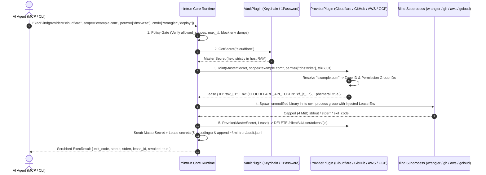

<div align="center">


<br />

# mintrun

### **Authority. Without possession.**

The zero-knowledge Just-In-Time (JIT) credential enclave, blind CLI runner, and MCP server for autonomous AI agents.<br />
Engineered with **100% Go standard library**, **zero external dependencies**, and an **Everything is a Plugin** architecture.

<p align="center">
  <a href="https://github.com/ninja-c9/mintrun/blob/main/go.mod"></a>
  <a href="#architecture-everything-is-a-plugin"></a>
  <a href="#ai-agent-integration-mcp"></a>
  <a href="#verification--testing"></a>
</p>

<p align="center">
  <a href="#why-mintrun">Why mintrun</a> ·
  <a href="#how-it-works">How It Works</a> ·
  <a href="#architecture-everything-is-a-plugin">Architecture</a> ·
  <a href="#quick-start">Quick Start</a> ·
  <a href="#built-for-every-cli">Cloud CLIs</a> ·
  <a href="#ai-agent-integration-mcp">MCP Integration</a> ·
  <a href="#defense-in-depth-security-model">Security &amp; Policy</a> ·
  <a href="#polyglot-plugin-sdk">Plugin SDK</a> ·
  <a href="#roadmap">Roadmap</a>
</p>

</div>

---

## Why mintrun

### **Your vault keeps the master key. Your agent borrows a scoped lease.**

AI coding agents (**Google Antigravity**, **Claude Code**, **Cursor**, **Windsurf**, **Codex**) deploy Cloudflare Workers, open GitHub pull requests, assume AWS roles, and inspect Google Cloud storage.

Yet every existing way of handing credentials to an agent forces a bad trade-off:
- **Plaintext `.env` files & MCP configs** expose long-lived keys directly to the LLM context window and cloud transcripts.
- **Static CLI wrappers (`op run`, `doppler run`, decoy shims)** hide the file on disk, but still inject your full-privilege static token into the child process, miss encoded stdout leaks (Base64, Hex, URL), and offer no scope-down or policy gate.
- **Cloud-locked agent vaults** force you to migrate your secrets out of macOS Keychain or 1Password into a third-party cloud just to run local CLIs.

`mintrun` takes a fundamentally different approach: **Bring Your Own Vault + True JIT Scope-Down + Blind Native CLI Execution.**

| Dimension | Plaintext `.env` / MCP Configs | Static CLI Wrappers (`op run` / Shims) | **The `mintrun` Enclave** |
| :--- | :--- | :--- | :--- |
| **Where master secrets live** | `.env` files, shell profiles, or MCP JSON | Existing vault, or a proprietary cloud vault | **Your existing vault** (`keychain`, `libsecret`, `1password`, or AES-256-GCM local fallback) |
| **What the AI agent sees** | Raw, long-lived API tokens in LLM context | Zero raw tokens, unless echoed in an encoded form | **Zero raw secrets.** The agent requests a provider, a scope, permissions, and a command |
| **What the child CLI receives** | Account-wide permanent credential | Account-wide permanent credential | **Narrowly scoped JIT sub-token** locked to 1 zone, 1 repo, 1 IAM role ARN, or specific OAuth2 scopes |
| **Token lifetime** | Weeks, months, or never rotated | Weeks, months, or never rotated | **Seconds to minutes.** Cloudflare & GitHub sub-tokens are deleted (`DELETE`) the instant the command exits; AWS STS & GCP tokens cannot be revoked early and expire on their own (AWS ≥ 15 min, GCP ≤ 1 h) |
| **Stdout / Stderr scrubbing** | None | Exact raw string match only | **5-Encoding Scrubber** redacts Raw, Base64, RawBase64, Hex, and URL-encoded forms with `[MINTRUN:REDACTED]` |
| **Exfiltration & policy gate** | None | None | **Fail-closed `policy.json`** blocks `env`/`printenv`, restricts scopes/permissions, isolates child env, and can ask a human first (macOS dialog or Telegram) |
| **Supply-chain footprint** | N/A | Dozens to hundreds of external packages | **0 external dependencies.** 100% Go 1.24 standard library |

> **Design Principle — Separate Authority from Possession:**
> An AI agent never needs to *possess* your Cloudflare token, GitHub App key, AWS secret key, or GCP service-account JSON to run `wrangler`, `gh`, `aws`, or `gcloud`. Your unmodified native CLIs already read standard environment variables—`mintrun` simply mints a disposable credential in memory, runs the binary blindly, scrubs the output, and revokes the lease on exit.

---

## How It Works

<div align="center">
  
</div>

Every time you—or an AI agent over MCP—invoke `mintrun exec`, the runtime executes a deterministic five-stage pipeline:



Stage 5 reports revocation honestly. **Cloudflare** and **GitHub** delete the sub-token immediately over the API, so `revoked: true`. **AWS STS** and **Google Cloud** service-account tokens cannot be invalidated early server-side, so the result reports `revoked: false` and the credentials live until their expiry.

---

## Architecture (`Everything is a Plugin`)

<div align="center">
  
</div>

`mintrun` is built around a tiny, zero-dependency Go kernel (`internal/core`) where secret storage, credential minting, and agent transport are pluggable contracts:

| Plugin Kind | Go Interface | Responsibility | Built-in Implementations |
| :--- | :--- | :--- | :--- |
| **`vault`** | `core.VaultPlugin` | Stores and retrieves long-lived master credentials outside agent context | • **`keychain`** — macOS Keychain (`/usr/bin/security -i`) or Linux libsecret (`secret-tool`), with the secret passed on `stdin` only, never `argv` (a macOS secret too long for one `security -i` line is split across up to 16 Keychain items behind a checksummed header, up to 24,000 bytes), plus an **AES-256-GCM** encrypted `0600` local fallback (`~/.mintrun/vault.json`); the fallback requires a **`MINTRUN_VAULT_KEY`** passphrase (PBKDF2-HMAC-SHA256 key, per-vault random salt), and a failing keystore call prints a warning before it is used. See [what the vault protects](#5-what-the-vault-protects-and-what-it-does-not)<br />• **`1password`** — 1Password CLI (`op`) vault (`op://` URIs & `mintrun:<provider>` items); `secret set` pipes a JSON item template to `op item create` on `stdin` and archives older items with the same title |
| **`provider`** | `core.ProviderPlugin` | Mints short-lived, resource-scoped sub-tokens from a master secret and revokes them on exit where the API allows it | • **`cloudflare`** — Resolves domain names to Zone IDs, maps permissions (`dns:write`, `workers:write`), mints via `POST /client/v4/user/tokens`, and revokes via `DELETE /client/v4/user/tokens/{id}`<br />• **`github`** — Signs RS256 App JWTs (PKCS#1/PKCS#8), mints repo-scoped Installation Tokens (`GITHUB_TOKEN`, `GH_TOKEN`), and revokes via `DELETE /installation/token`<br />• **`aws`** — 100% stdlib SigV4 `STS AssumeRole` JIT minter for the role ARN given as the scope (`arn:aws:iam::<account_id>:role/<name>`), with inline session policy narrowing (`AWS_ACCESS_KEY_ID`, `AWS_SECRET_ACCESS_KEY`, `AWS_SESSION_TOKEN`); a session token in the master secret is signed with the request. STS credentials cannot be revoked early, so leases report `revoked: false` and live until their expiry, at least 15 min (the STS minimum duration)<br />• **`gcp`** — Signs an RS256 JWT bearer assertion (RFC 7523) from a service-account JSON key, exchanges it for an OAuth2 access token limited to the requested scopes (`cloud-platform.read-only`, `devstorage.read_only`, …), and injects `CLOUDSDK_AUTH_ACCESS_TOKEN` + `GOOGLE_OAUTH_ACCESS_TOKEN`. Revocation on exit is best-effort: Google does not revoke service-account tokens server-side, so they live until their fixed ≤1h expiry |
| **`bridge`** | `core.BridgePlugin` | Exposes `mintrun` capabilities to external AI agent harnesses | • **`mcp`** — Full Model Context Protocol (JSON-RPC 2.0 over `stdio`) server exposing `mintrun_exec`, `mintrun_plugins`, and the read-only governance tools `mintrun_policy_check` and `mintrun_audit` |

### Repository Layout

```text
mintrun/
├── cmd/mintrun/
│   ├── main.go                           # CLI entrypoint (exec, secret, plugin, mcp, audit)
│   ├── main_test.go                      # End-to-end CLI & subcommand test suite
│   └── examples_test.go                  # Installs and runs the example plugins against stand-ins
├── internal/
│   ├── core/
│   │   ├── plugin.go                     # Plugin ABI, Registry, SHA-256 pinning & ExternalPlugin SDK
│   │   ├── runner.go                     # ExecBlind lifecycle, Policy Engine, 5-Encoding Scrubber, Output Cap, TailAudit
│   │   ├── procgroup_*.go                # Process-group kill on timeout/cancel (Unix; no-op elsewhere)
│   │   └── core_test.go                  # Core JIT mint, scrub, revoke, policy & MCP test suite
│   └── builtin/
│       ├── keychain.go                   # macOS Keychain / Linux libsecret + AES-256-GCM fallback & 1Password vault
│       ├── cloudflare.go                 # Built-in Cloudflare, GitHub (RS256 JWT), AWS STS (SigV4) & GCP (JWT bearer) providers
│       ├── mcp.go                        # MCP JSON-RPC 2.0 stdio bridge server
│       ├── telegram.go                   # Telegram approval channel (Bot API long polling)
│       ├── builtin_test.go               # Comprehensive provider, vault, and MCP unit test suite
│       ├── telegram_test.go              # Telegram approval against a local Bot API
│       └── keychain_integration_test.go  # Real macOS Keychain round trip (`-tags integration` only)
├── examples/plugins/                     # Plugins built into the binary (`plugin install <name>`): bitwarden (vault), vercel & postgres-jit (providers)
└── docs/
    ├── assets/                           # SVG architectural diagrams
    └── video/                            # Self-contained HTML/MP4 motion overview & storyboard
```

---

## Quick Start

### 1. Install `mintrun`

```bash
# Install directly with Go 1.24+:
go install github.com/ninja-c9/mintrun/cmd/mintrun@latest

# Or clone and build a reproducible binary from source:
git clone https://github.com/ninja-c9/mintrun.git
cd mintrun
go build -trimpath -o mintrun ./cmd/mintrun
```

### 2. Enroll Your Master Secret Once

Store your master credential in the OS keystore. `mintrun` never modifies or replaces your existing cloud CLIs—it injects ephemeral credentials at runtime.

```bash
# Prompts on stdin with terminal echo off, so your master secret never appears
# on screen, in shell history, or in `ps`:
./mintrun secret set cloudflare

# Verify existence without ever printing the secret value:
./mintrun secret check cloudflare
# -> Secret "cloudflare" is configured in vault "keychain" (length=40 chars, value hidden).

# Piped or redirected input is read whole, so multi-line secrets such as a GCP
# service-account JSON key or a GitHub App PEM survive intact (and stay off argv):
./mintrun secret set gcp < sa-key.json
```

`mintrun secret set <provider> <secret>` still works, but prints a warning: an argument is visible in shell history and `ps`. On macOS, a secret too long for one `security -i` line (about 2 KB, such as a GCP service-account JSON or a GitHub App PEM) is split across up to 16 Keychain items, 24,000 bytes in all; a longer one is stored in the encrypted file vault with a warning, and that needs `MINTRUN_VAULT_KEY` set.

`mintrun` reads the Keychain or libsecret before the encrypted file vault, so `secret set` removes the older copy from the other store: a keystore store removes the file-vault copy (without `MINTRUN_VAULT_KEY` it cannot decrypt `vault.json`, so it warns that the copy may remain), and a store that falls back to the file vault removes the keystore item. If the keystore exists but cannot be reached (for example, `secret-tool` without a D-Bus session), that removal can fail too, and `secret set` then exits non-zero after storing the secret in the file vault. On such a host, set `MINTRUN_FILE_VAULT=1` wherever `mintrun` runs (your shell and the MCP server config) to use only the encrypted file vault.

---

## Built for Every CLI

`mintrun` wraps your unmodified native binaries (`wrangler`, `gh`, `aws`, `gcloud`, `terraform`, `curl`) and injects standard environment variables into the blind child process.

### Cloudflare (`wrangler`)
Create a Cloudflare API Token with **`User -> API Tokens -> Edit`** so `mintrun` can mint and revoke disposable child tokens on your behalf:

```bash
# Mint a sub-token locked ONLY to `example.com` with DNS + Workers write access,
# run Wrangler, scrub stdout/stderr, and DELETE the sub-token when Wrangler exits:
./mintrun exec \
  -provider cloudflare \
  -scope example.com \
  -perms dns:write,workers:write \
  -ttl 300 \
  -- npx wrangler deploy
```

### GitHub CLI (`gh` & `git`)
Store a GitHub App credential formatted as `<app_id>:<installation_id>:<private_key_pem>` (or `<app_id>::<private_key_pem>` when MCP agents select an installation via `params.installation_id`):

```bash
# Enroll your GitHub App credential via stdin:
printf '%s:%s:%s' "123456" "87654321" "$(cat app-private-key.pem)" | ./mintrun secret set github

# Mint a repository-scoped installation token, run `gh`, and revoke it on exit:
./mintrun exec \
  -provider github \
  -scope ninja-c9/mintrun \
  -perms contents:write,pull_requests:write \
  -- gh pr create --fill
```

### AWS CLI (`aws` & `terraform`)
Store IAM credentials formatted as `<access_key_id>:<secret_access_key>[:<session_token>]`. `mintrun` signs an `STS AssumeRole` request with 100% stdlib SigV4 and narrows the session with an inline IAM policy:

```bash
./mintrun exec \
  -provider aws \
  -scope arn:aws:iam::123456789012:role/DeployRole \
  -perms s3:GetObject,s3:PutObject \
  -ttl 900 \
  -- aws s3 ls s3://my-Bucket
```

### Google Cloud SDK (`gcloud` & `gsutil`)
Permissions map to OAuth2 scopes (short names expand under `https://www.googleapis.com/auth/`). Add `-clean-env` so the child only sees `PATH`, `HOME`, `TMPDIR`, `USER`, `LANG`, `TERM`, `SSL_CERT_FILE`, your policy's `allowed_env`, and the lease credential:

```bash
./mintrun exec \
  -provider gcp \
  -perms cloud-platform.read-only \
  -clean-env \
  -- gcloud storage ls gs://my-bucket
```

> **Explicit Static Wrapper Mode:** Already have a pre-scoped token (such as a Cloudflare scoped token, a GitHub PAT, stored AWS IAM keys, or a GCP OAuth2 access token) and only want zero-knowledge injection + 5-encoding output scrubbing? Request static mode explicitly with `-perms static` (MCP: `"permissions": ["static"]`). Because static mode hands the stored secret directly to the child without minting a disposable token, the provider must also opt in with `"allow_static": true` in `policy.json`:
> ```bash
> ./mintrun exec -provider github -perms static -- gh issue list -R ninja-c9/mintrun
> ```
> ```json
> { "github": { "allow_static": true } }
> ```
> Static mode never wraps a private key the provider signs with: `github` refuses a GitHub App private key and `gcp` refuses a service-account JSON or PEM key.
>
> **Migration (breaking change):** `github` used to fall back to static mode for a PAT, and `aws` for any scope that is not an `arn:aws:` role ARN, which skipped the `allow_static` gate. Both now fail with an error that names the opt-in. To keep injecting a GitHub PAT or stored IAM keys, add `-perms static` and `"allow_static": true` for `github` or `aws`. GitHub App credentials and AWS role-ARN scopes mint JIT credentials as before.

### Inspect the Zero-Secret Audit Trail

Every execution is recorded in `~/.mintrun/audit.jsonl` with lease metadata, exit code, revocation status, and `truncated` when an output stream hit the 4 MiB cap. Secrets the runner holds (master secret, lease credentials) are scrubbed. A policy-denied entry keeps its raw command because no secret is loaded yet, so never put a secret in `argv`; MCP `mintrun_audit` shows agents only each command's binary name. `mintrun audit` and `mintrun_audit` stream the file through `core.TailAudit`, so their memory use does not grow with the log:

```bash
./mintrun audit -provider cloudflare -limit 5
```
```json
{"ts":"2026-10-15T04:20:00Z","provider":"cloudflare","scope":"example.com","permissions":["dns:write","workers:write"],"command":["npx","wrangler","deploy"],"lease_id":"9a8b7c6d5e","ephemeral":true,"revoked":true,"exit_code":0,"duration_ms":1840}
```

---

## AI Agent Integration (MCP)

Connect `mintrun` to **Google Antigravity**, **Claude Code**, **Cursor**, or **Windsurf** so your agent can execute authenticated CLI workflows without ever seeing raw credentials:

```json
{
  "mcpServers": {
    "mintrun": {
      "command": "/path/to/mintrun",
      "args": ["mcp"]
    }
  }
}
```

### Exposed MCP Tools

| Tool Name | Description | Key Parameters |
| :--- | :--- | :--- |
| **`mintrun_exec`** | Mints a scoped JIT credential, runs the target CLI command in a blind subprocess, scrubs all secret strings from `stdout`/`stderr`, and revokes the credential before returning where the provider allows it (AWS STS and GCP credentials can only expire; `revoked` reports which). Each output stream is capped at 4 MiB; `truncated: true` marks a cut. | `provider` (`"cloudflare"`), `scope` (`"example.com"`), `permissions` (`["dns:write","workers:write"]`), `command` (`["wrangler","deploy"]`), `cwd`, `ttl_seconds`, `clean_env`, `params` (`{"installation_id":"12345678"}` picks a `github` App installation) |
| **`mintrun_plugins`** | Lists all registered built-in and external plugins (`vault`, `provider`, `bridge`) along with their supported permission scopes. | *(none)* |
| **`mintrun_policy_check`** | Dry-runs a `mintrun_exec` request against `policy.json` and the anti-exfiltration guard, through the same gate `mintrun_exec` enforces. Never opens the vault, mints, runs the command, or asks a human. Returns `allowed`, the denial `reason` (the exact error `mintrun_exec` would return), `approval_required`, `ttl_seconds` (the TTL requested from the provider after `max_ttl_seconds`; `gcp` tokens always live up to 1h), and `clean_env`. | Same as `mintrun_exec` |
| **`mintrun_audit`** | Returns recent audit entries, oldest first, filtered like `mintrun audit`. Each command is cut to its binary name plus `[MINTRUN:REDACTED]`: a policy-denied entry keeps the raw `argv` (no secret is loaded yet to scrub against), and a secret typed into `argv` is one the runner never holds, so arguments never reach an agent. The on-disk log keeps the full `argv` for the operator. | `provider` (case-insensitive), `failed_only`, `limit` (default 20, max 100) |

### Approve From Your Phone (Telegram)

`mintrun exec -approve`, `MINTRUN_APPROVE=1` in `mintrun`'s environment, and `"require_approval": true` in a provider's policy ask a human before anything is minted; the last two also cover an agent's `mintrun_exec` calls. On macOS a dialog asks. With a Telegram bot set up, your phone is asked at the same time, so you can approve an agent's commands away from the machine. The first answer, from either, wins and closes the other.

1. Create a bot for `mintrun` alone with [@BotFather](https://t.me/BotFather), and send it `/start` from your account so it may message you.
2. Store your numeric Telegram user ID (not your @username) and the bot token in the default vault:

```bash
mintrun secret set approval-telegram    # enter <user_id>:<bot_token>
```

- **Only your tap on this request's message counts.** A tap from another account, or on another request's message, is ignored. The message is then edited to show the outcome.
- **Ten minutes, then no.** Telegram gives up after 10 minutes and the request is not approved, while the macOS dialog, which has no timeout, keeps waiting. On Linux, where there is no dialog, Telegram is the only channel. With neither, `-approve` fails closed.
- **A bot of its own.** `mintrun` reads taps with `getUpdates`, which Telegram refuses while the bot has a webhook.
- **The default vault only.** The setting is read from the default vault (`MINTRUN_VAULT`, or `keychain`), never from the vault a request names, so an agent cannot send approvals to a bot it controls.
- **Every field quoted.** The dialog and the message show each field an agent sets in quotes, so a line break in an argument shows as `\n` and cannot pose as a line of the request. A request too long to show ends in a TRUNCATED warning: deny it unless you know the rest.
- **What Telegram sees.** The message carries the provider, scope, permissions, params, and command through Telegram's servers. It holds no secret, because approval comes before any secret is loaded, but a secret typed into the command's arguments would be in it.
- **No Slack.** A Slack incoming webhook only sends, so it cannot carry your answer back.

---

## Defense-in-Depth Security Model

### 1. Declarative Policy Guardrails (`~/.mintrun/policy.json`)

Restrict which domains, repositories, roles, or permissions an AI agent may touch, cap lease TTLs, enforce a minimal child environment, or require human approval (macOS dialog or [Telegram](#approve-from-your-phone-telegram)) per provider in `~/.mintrun/policy.json`:

```json
{
  "cloudflare": {
    "allowed_scopes": ["staging.example.com", "sandbox.example.com"],
    "blocked_commands": ["delete", "r2 bucket delete", "curl"],
    "max_ttl_seconds": 300
  },
  "github": {
    "allowed_scopes": ["ninja-c9/*"],
    "allowed_permissions": ["contents:read", "contents:write", "pull_requests:write", "issues:write"],
    "blocked_commands": ["repo delete", "secret"],
    "max_ttl_seconds": 600
  },
  "gcp": {
    "allowed_permissions": ["cloud-platform.read-only", "devstorage.read_only"],
    "clean_env": true,
    "allowed_env": ["CLOUDSDK_CORE_PROJECT"]
  }
}
```

If `~/.mintrun/policy.json` exists but is malformed JSON, `mintrun` **fails closed** and denies every execution until the file is fixed.

**Child environment isolation:** `clean_env: true` (or any non-empty `allowed_env`) runs the command with only `PATH`, `HOME`, `TMPDIR`, `USER`, `LANG`, `TERM`, `SSL_CERT_FILE`, the `allowed_env` globs, and the lease env, so ambient host secrets such as `SSH_AUTH_SOCK` or other cloud keys never reach the child. A caller can request the same per run with `-clean-env` (CLI) or `clean_env` (MCP), but cannot switch off a policy that enables it. `MINTRUN_VAULT_KEY` is never passed to a child, even when allowlisted.

**GitHub App installations:** a credential stored as `<app_id>:<installation_id>:<private_key_pem>` or `<installation_id>:<app_jwt>` pins one installation, and `github` refuses an MCP `params.installation_id` that names a different one before any request reaches GitHub, so a pinned credential needs no policy rule. To let agents pick among several installations, store `<app_id>::<private_key_pem>` (no installation) and list the IDs they may use:

```json
{ "github": { "allowed_installations": ["12345678", "87654321"] } }
```

Once `allowed_installations` is set, every request for that provider must carry a listed `params.installation_id` (exact match, no wildcards), even if the stored credential pins one, and `mintrun_policy_check` reports the same denial. The CLI sends no `params`, so it cannot use a provider with this rule.

### 2. Anti-Exfiltration Command Filter

Even without a custom `policy.json`, `mintrun` automatically blocks trivial environment-dumping commands (`env`, `printenv`, `export`, `/proc/self/environ`) at the policy gate before any secret is unlocked or minted.

### 3. Five-Encoding Output Scrubber

Before `ExecBlind` returns `stdout`, `stderr`, `LeaseID`, or process error messages to the caller or MCP bridge, `core.Scrub()` replaces every occurrence of:
1. The **Master Secret**
2. Every injected **`Lease.Env`** value
3. Any additional provider-specified **`Lease.Redact`** and **`Lease.RevokeSecret`** tokens

across **Raw**, **Base64**, **RawBase64**, **Hex**, and **URL-encoded** representations with `[MINTRUN:REDACTED]`.

### 4. Bounded Output & Process-Group Kill

Each child stream keeps its first 4 MiB; the rest is counted and dropped, so a runaway command cannot exhaust memory. A cut stream ends with `[MINTRUN:TRUNCATED <n> bytes]`, and the result and audit entry carry `truncated: true`. A tail that could be the start of a secret variant is dropped before scrubbing, so the cut never leaves half a secret behind.

On Unix the command runs in its own process group. A timeout (5 min by default) or a `SIGINT` / `SIGTERM` / `SIGHUP` to `mintrun` kills the whole group with `SIGKILL`, so no grandchild keeps running with the lease, and the lease is still revoked and audited. Two side effects: a command that reads the terminal directly (`/dev/tty`) is stopped by `SIGTTIN` until the timeout, and a background process the command leaves behind after a clean exit is not killed (`mintrun` stops waiting for its output 5 s after the command exits).

### 5. What the Vault Protects and What It Does Not

| Store | Protects against | Does **not** protect against |
| :--- | :--- | :--- |
| **macOS Keychain / Linux libsecret** | Other users and a copy of the disk; the secret never touches `argv`, `ps`, or shell history | Any process running as your user while the keychain is unlocked: it can run `security find-generic-password` or `secret-tool lookup` itself |
| **Encrypted file vault** (`~/.mintrun/vault.json`) | A copy of `vault.json` (backup, sync folder, lost disk) without the passphrase: AES-256-GCM with a key derived from `MINTRUN_VAULT_KEY` (PBKDF2-HMAC-SHA256, 210,000 iterations, per-vault random salt); a tampered file fails to decrypt | Any process running as your user that can read both `vault.json` and the passphrase (from a shell profile, an MCP config file, or, on Linux, `mintrun`'s environment), a keylogger, or offline guessing of a weak passphrase |

The blind command is such a process. `mintrun` never passes `MINTRUN_VAULT_KEY` to it, which stops accidental exposure (an `env` dump, a debug log), but a command written to steal secrets can still query the keystore, or read `vault.json` and look for the passphrase (a shell profile, an MCP config file, and on Linux `mintrun`'s own environment through `/proc/$PPID/environ`). On macOS 27.0, `ps -E` and `sysctl` showed another process's arguments but not its environment in our test; older releases are untested. `mintrun` keeps raw secrets out of the agent's context and transcripts; it does not sandbox the command it runs. Block what an agent must not run with `blocked_commands`, and use `require_approval` (macOS dialog or Telegram) to see each command before it runs.

### 6. Known Gap: No Network Sandbox

A blind command keeps network access, so it can send its lease credential elsewhere (`curl`, `nc`, any script interpreter). `blocked_commands` (e.g. `curl`, `wget`, `nc`), `clean_env`, and short TTLs narrow this; they do not stop an interpreter. A planned `no_network: true` policy flag would run the command in a Linux network namespace or a macOS `sandbox-exec` deny-network profile, and refuse to run when neither is available. It needs per-OS integration tests before it can be trusted, so it is not built yet.

---

## Polyglot Plugin SDK

Because **everything in `mintrun` is a plugin**, any developer can extend `mintrun` with new third-party Vaults (`lastpass`, `bitwarden`, `hashicorp-vault`) or JIT Providers (`vercel`, `supabase`, `digitalocean`, `stripe`) in **any language** (Python, Bash, Node.js, Go, Rust) without recompiling the binary. External plugins cannot override built-in plugin names.

Three working plugins ship in [`examples/plugins/`](examples/plugins/README.md) and are built into the binary: a `bitwarden` vault, and `vercel` and `postgres-jit` providers. `mintrun plugin install <name>` installs one with no clone or download.

### Managing Plugins

```bash
# List all built-in and installed external plugins
./mintrun plugin list

# Install a plugin built into the binary by name: bitwarden, vercel, or postgres-jit
./mintrun plugin install bitwarden

# Install from a local directory containing plugin.json + executable entrypoint.
# Give it as a path: a bare name built into the binary installs the built-in copy,
# never a directory of that name in the current directory.
./mintrun plugin install ./examples/plugins/bitwarden

# Install a single-file remote plugin bundle over HTTPS with mandatory out-of-band SHA-256 pinning
./mintrun plugin install "https://registry.example.com/plugins/bitwarden.json#sha256=e3b0c44298fc1c149afbf4c8996fb92427ae41e4649b934ca495991b7852b855"

# Use an installed external vault for a single command or as the default vault
./mintrun exec -vault bitwarden -provider cloudflare -scope example.com -- npx wrangler deploy
export MINTRUN_VAULT=bitwarden

# Remove an external plugin
./mintrun plugin remove bitwarden
```

### Writing an External Plugin (`stdin` $\rightarrow$ `stdout` JSON Protocol)

Place a `plugin.json` manifest and an executable entrypoint inside `~/.mintrun/plugins/<name>/` (or publish a single-file JSON bundle with `"script"` for remote installation):

**1. `plugin.json`** (from [`examples/plugins/vercel`](examples/plugins/vercel/plugin.json))
```json
{
  "name": "vercel",
  "version": "0.1.0",
  "kind": "provider",
  "description": "Mints a Vercel token that expires with the lease and deletes it on exit",
  "entrypoint": "run",
  "scopes": ["<project_id>", "<team_id>/<project_id>"]
}
```

**2. Request Payload (`stdin` to `entrypoint`)**
```json
{
  "op": "mint",
  "master_secret": "<resolved-from-vault>",
  "mint_request": {
    "provider": "vercel",
    "scope": "team_abc/prj_def",
    "ttl_seconds": 900
  }
}
```
*(For a `"kind": "vault"` plugin such as [`bitwarden`](examples/plugins/bitwarden/run), `mintrun` sends `"op": "get_secret"`, `"set_secret"`, or `"delete_secret"` with `"key"` and `"value"`, and expects `{"value": "..."}` on `stdout`.)*

**3. Response Payload (`stdout` from `entrypoint`)**
```json
{
  "lease": {
    "id": "<vercel-token-id>",
    "provider": "vercel",
    "scope": "team_abc/prj_def",
    "env": {
      "VERCEL_TOKEN": "<new-bearer-token>"
    },
    "redact": ["<new-bearer-token>"],
    "expires_at": "2026-10-16T10:15:00Z",
    "ephemeral": true
  }
}
```

When the child command finishes, `mintrun` invokes your provider plugin again with `{"op": "revoke", "master_secret": "...", "lease": {...}}` so it can invalidate the token. If the token cannot be invalidated early and can only expire, reply `{"error": "..."}`, and `mintrun` reports `revoked: false`.

Put only secrets in `env`. `mintrun` removes every `env` value, every `redact` entry, and the lease `id` from the command's output, so a non-secret such as a port number would be blanked wherever it appears. The `id` is public: the audit log and the MCP result show it.

---

## Roadmap

`mintrun` is actively evolving toward a complete zero-trust execution standard for autonomous AI agents:

| Milestone | Status | Key Deliverables |
| :--- | :---: | :--- |
| **`v0.1.0` — Core Runtime & Enclave ABI** | ✅ **Done** | • Zero-dependency Go core runtime & `Vault` / `Provider` / `Bridge` ABI<br />• Native macOS Keychain vault + `0600` local fallback<br />• Cloudflare JIT Sub-Token provider (auto zone resolution + instant `DELETE` revoke)<br />• MCP JSON-RPC 2.0 `stdio` bridge (`mintrun_exec`, `mintrun_plugins`)<br />• Stream Scrubber, Policy Engine (`policy.json`), and JSONL Audit Logger |
| **`v0.2.0` — Multi-Cloud JIT Providers & Vaults** | ✅ **Done** | • **Built-in GitHub App & PAT Provider (`github`)**: RS256 JWT signing + repo/permission-scoped installation token minting & instant `DELETE /installation/token` revocation<br />• **Built-in 1Password CLI (`op`) Vault (`1password`)**: Biometric TouchID unlock & `op://` URI support |
| **`v0.3.0` — Enclave Hardening & HITL Approval** | ✅ **Done** | • **Encoding-Aware Scrubber**: Redacts raw, Base64, RawBase64, Hex, and URL-encoded secret leaks<br />• **Human-in-the-Loop (HITL) Prompt (`-approve` / `require_approval`)**: Native macOS `osascript` Security Enclave confirmation gate<br />• **SHA-256 Remote Plugin Integrity**: Cryptographic digest pinning (`#sha256=...`) for remote plugin bundles |
| **`v0.4.0` — AWS STS, AES-256-GCM Vault & Governance** | ✅ **Done** | • **Built-in AWS STS (`AssumeRole`) Provider (`aws`)**: 100% stdlib SigV4 signing & inline IAM session policy narrowing<br />• **AES-256-GCM Encrypted Local Vault**: Authenticated encryption at rest for `~/.mintrun/vault.json`<br />• **Wildcard Policy & Audit Filtering**: `allowed_permissions` / `allowed_scopes` globs and `mintrun audit -provider -failed -limit` |
| **`v0.5.0` — Env Isolation, GCP & Linux Vault** | ✅ **Done** | • ✅ **Child Environment Isolation**: `-clean-env` / MCP `clean_env` and policy `clean_env` / `allowed_env` globs; `MINTRUN_VAULT_KEY` is never inherited<br />• ✅ **Built-in GCP Provider (`gcp`)**: 100% stdlib RS256 JWT bearer grant from a service-account key, scoped OAuth2 access token, best-effort revoke<br />• ✅ **Linux libsecret Vault**: `secret-tool` backend for `keychain` (secret on `stdin`, encrypted file fallback)<br />• ✅ **MCP Governance Tools**: `mintrun_policy_check` (policy dry run on the same gate as `mintrun_exec`) & `mintrun_audit` (filtered audit log, arguments redacted) |
| **`v0.6.0` — Operational Hardening** | ✅ **Done** | • ✅ **Keychain Secrets Off argv**: macOS `security -i` over `stdin`, multi-line-safe reads, a hidden `secret set` prompt, and a warning for a secret given as an argument<br />• ✅ **Loud Keystore Fallback**: a failing Keychain/libsecret call warns before the encrypted file vault takes over<br />• ✅ **Bounded, Killable Child**: 4 MiB output cap per stream with straddle-safe scrubbing; process-group kill on timeout or `SIGINT`/`SIGTERM`/`SIGHUP`<br />• ✅ **Honest AWS Leases**: SigV4 signs the session token; STS leases report `revoked: false` (expiry only)<br />• ✅ **Hermetic Tests**: the real-Keychain test runs only with `-tags integration`<br />• ✅ **Explicit Static Mode**: `github` and `aws` inject a PAT or stored IAM keys only on an explicit `static` request that `allow_static` permits |
| **`v0.7.0` — GitHub Installation Binding** | ✅ **Done** | • ✅ **Consistent GitHub Credential Parsing**: `params.installation_id` only fills in the installation ID, never how the stored credential is read, and a private key never reaches an HTTP header<br />• ✅ **Installation Pin**: a credential stored as `<app_id>:<installation_id>:<private_key_pem>` or `<installation_id>:<app_jwt>` refuses a different `params.installation_id` before any request<br />• ✅ **`allowed_installations` Policy**: an exact, fail-closed allowlist in the same gate as `mintrun_exec` and `mintrun_policy_check`<br />• ✅ **MCP `params` Schema**: `mintrun_exec` and `mintrun_policy_check` advertise `params` |
| **`v0.8.0` — Secrets Off argv, Bounded Audit Reads & Long Keychain Secrets** | ✅ **Done** | • ✅ **1Password Secrets Off argv**: `secret set` pipes a JSON item template to `op item create` on `stdin` and archives older items with the same title<br />• ✅ **Bounded Audit Reads**: `mintrun audit` and MCP `mintrun_audit` stream `audit.jsonl`, so memory no longer grows with the log<br />• ✅ **Long Keychain Secrets**: a secret too long for one `security -i` line is stored as up to 16 checksummed parts (24,000 bytes)<br />• ✅ **Tested Hidden Prompt**: a test covers the echo-off `secret set` prompt with a stub `stty` |
| **`v0.9.0` — Keystore Cleanup, Example Plugins & Phone Approval** | ✅ **Done** | • ✅ **No Stale Copies**: a `secret set` that falls back to the file vault removes the older Keychain or libsecret item, and a keystore store removes the older `vault.json` copy, or each says it could not<br />• ✅ **Example Plugins**: `bitwarden` (vault), `vercel` and `postgres-jit` (providers) in [`examples/plugins/`](examples/plugins/), Python 3.9+ standard library; `postgres-jit` has run against real PostgreSQL 15 and 16<br />• ✅ **Approve From Your Phone**: `-approve` and `require_approval` ask the macOS dialog and a Telegram bot at once, and the first answer wins |

---

## Verification & Testing

`mintrun` ships with a deterministic, offline unit and integration test suite (**94.0%** total statement coverage, measured without build tags) that mocks Cloudflare, GitHub App RS256, AWS STS SigV4 (plus a fixed AWS signing vector), Google OAuth2 JWT-bearer, and Telegram Bot APIs plus the macOS `security` and `osascript`, Linux `secret-tool`, 1Password `op`, and `stty` CLIs, checks child environment isolation, the output cap, and the process-group kill, verifies AES-256-GCM encryption at rest, tests multi-encoding leak scrubbing, enforces policy guardrails, validates external plugin execution and the governance tools over MCP, and installs and runs the [example plugins](examples/plugins/README.md) against a stub `bw`, a stub `psql`, and a local Vercel API (skipped without `python3`). It never touches the real Keychain, Telegram, Bitwarden, Vercel, or a database:

```bash
go test -v -cover ./...

# macOS only: round-trip throwaway single-item and multi-part secrets through the real Keychain
go test -tags integration -count=1 -v -run TestKeychainVaultRealKeychain ./internal/builtin
```

---

<div align="center">
  <sub>Built with precision for the autonomous agent era · <b>mintrun</b></sub>
</div>
