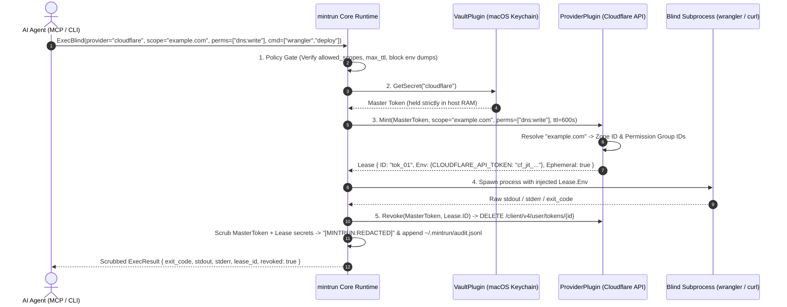

<div align="center">


<br />

# mintrun

### **Give AI agents the authority to deploy. Never the raw keys.**

Zero-knowledge Just-In-Time (JIT) credential minter, blind CLI runner, and MCP enclave.<br />
Built with **100% Go standard library**, **zero external dependencies**, and an **Everything is a Plugin** architecture.

<p align="center">
  <a href="https://github.com/ninja-c9/mintrun/blob/main/go.mod"></a>
  <a href="#architecture-everything-is-a-plugin"></a>
  <a href="#ai-agent-integration-mcp"></a>
  <a href="#defense-in-depth-security-model"></a>
</p>

<p align="center">
  <a href="#the-vision">The Vision</a> ·
  <a href="#how-it-works">How It Works</a> ·
  <a href="#architecture-everything-is-a-plugin">Architecture</a> ·
  <a href="#quick-start">Quick Start</a> ·
  <a href="#ai-agent-integration-mcp">MCP Integration</a> ·
  <a href="#defense-in-depth-security-model">Security &amp; Policy</a> ·
  <a href="#polyglot-plugin-sdk">Plugin SDK</a> ·
  <a href="#roadmap">Roadmap</a>
</p>

</div>

---

## The Vision

Modern AI coding agents (**Google Antigravity**, **Claude Code**, **Cursor**, **Windsurf**, **Codex**) are no longer passive autocomplete tools—they actively deploy Cloudflare Workers, update DNS records, manage GitHub releases, and run Terraform plans.

Yet the way we grant credentials to AI agents today is fundamentally broken:

| Dimension | The Legacy `.env` / Static Token Way | The **mintrun** Enclave Way |
| :--- | :--- | :--- |
| **Where secrets live** | Plaintext `.env` files, shell profiles, or MCP JSON configs | Hardware-backed **OS Native Keychain** (`VaultPlugin`) |
| **What the AI sees** | Full, long-lived API tokens inside the LLM context window | **Zero raw secrets.** The agent only requests a command & scope |
| **Blast radius** | Account-wide or multi-zone permanent keys | **JIT Sub-Token** locked to 1 zone/repo & specific permissions |
| **Token lifetime** | Weeks, months, or never rotated | **Seconds to minutes.** Cloudflare & GitHub sub-tokens are revoked (`DELETE`) the instant the command exits; AWS STS & GCP tokens cannot be revoked early and expire on their own (AWS ≥ 15 min, GCP ≤ 1 h) |
| **Accidental stdout leak** | Printed into terminal logs & uploaded to LLM cloud transcripts | Automatically scrubbed with `[MINTRUN:REDACTED]` before returning |
| **Exfiltration guard** | Agent can run `env` or `printenv` freely | Built-in **Policy Engine** blocks env-dumping & unauthorized scopes |

> **Core Philosophy — Separate Authority from Possession:**
> An AI agent does not need to *possess* your Cloudflare or GitHub API key to run `wrangler deploy` or `gh release create`. It only needs a trusted local enclave to execute that binary with a short-lived, narrowly scoped credential and return the scrubbed result.

---

## How It Works

<div align="center">
  
</div>

Every time you—or an AI agent via MCP—invoke `mintrun exec`, the runtime executes a deterministic five-stage lifecycle:



Stage 5 depends on the provider. Cloudflare and GitHub delete the sub-token, so `revoked: true`. AWS STS and GCP credentials cannot be revoked early, so the result reports `revoked: false` and they live until their expiry.

---

## Architecture (`Everything is a Plugin`)

<div align="center">
  
</div>

`mintrun` is engineered around a tiny, zero-dependency Go kernel (`internal/core`) where every capability—secret storage, credential minting, and agent transport—is a pluggable contract:

| Plugin Kind | Go Interface | Responsibility | Built-in Implementation |
| :--- | :--- | :--- | :--- |
| **`vault`** | `core.VaultPlugin` | Stores and retrieves long-lived master credentials outside agent context | • **`keychain`** — macOS Keychain (`/usr/bin/security -i`) or Linux libsecret (`secret-tool`), the secret passed on `stdin` only, never argv, with **AES-256-GCM** encrypted `0600` local fallback (`~/.mintrun/vault.json`); the fallback requires a **`MINTRUN_VAULT_KEY`** passphrase (PBKDF2-HMAC-SHA256 key, per-vault random salt), and a failing keystore call prints a warning before it is used. See [what the vault protects](#5-what-the-vault-protects-and-what-it-does-not)<br />• **`1password`** — 1Password CLI (`op`) biometric TouchID vault (`op://` URIs & `mintrun:<provider>` items) |
| **`provider`** | `core.ProviderPlugin` | Mints short-lived, resource-scoped sub-tokens from a master secret and revokes them on exit where the API allows it | • **`cloudflare`** — Resolves domain names to Zone IDs, maps permissions (`dns:write`, `workers:write`), mints via `POST /client/v4/user/tokens`, and revokes via `DELETE /client/v4/user/tokens/{id}`<br />• **`github`** — Signs RS256 App JWTs (PKCS#1/PKCS#8), mints repo-scoped Installation Tokens, and revokes via `DELETE /installation/token`<br />• **`aws`** — 100% stdlib SigV4 `STS AssumeRole` JIT minter for the role ARN given as the scope (`arn:aws:iam::<account_id>:role/<name>`), with inline session policy narrowing (`AWS_ACCESS_KEY_ID`, `AWS_SECRET_ACCESS_KEY`, `AWS_SESSION_TOKEN`); a session token in the master secret is signed with the request. STS credentials cannot be revoked early, so leases report `revoked: false` and live until their expiry, at least 15 min (the STS minimum duration)<br />• **`gcp`** — Signs an RS256 JWT bearer assertion (RFC 7523) from a service-account JSON key, exchanges it for an OAuth2 access token limited to the requested scopes (`cloud-platform.read-only`, `devstorage.read_only`, …), and injects `CLOUDSDK_AUTH_ACCESS_TOKEN` + `GOOGLE_OAUTH_ACCESS_TOKEN`. Revocation on exit is best-effort: Google does not revoke service-account tokens server-side, so they live until their fixed ≤1h expiry |
| **`bridge`** | `core.BridgePlugin` | Exposes `mintrun` capabilities to external AI agent harnesses | • **`mcp`** — Full Model Context Protocol (JSON-RPC 2.0 over `stdio`) server exposing `mintrun_exec`, `mintrun_plugins`, and the read-only governance tools `mintrun_policy_check` and `mintrun_audit` |

### Repository Layout

```text
mintrun/
├── cmd/mintrun/
│   ├── main.go                 # CLI entrypoint (exec, secret, plugin, mcp, audit)
│   └── main_test.go            # End-to-end CLI & subcommand test suite
├── internal/
│   ├── core/
│   │   ├── plugin.go           # Plugin ABI, Registry, SHA-256 pinning & ExternalPlugin SDK
│   │   ├── runner.go           # ExecBlind lifecycle, Policy Engine, Encoding Scrubber, Output Cap, Audit Logger
│   │   ├── procgroup_*.go      # Process-group kill on timeout/cancel (Unix; no-op elsewhere)
│   │   └── core_test.go        # Core JIT mint, scrub, revoke, policy & MCP test suite
│   └── builtin/
│       ├── keychain.go         # macOS Keychain / Linux libsecret + AES-256-GCM fallback & 1Password vault
│       ├── cloudflare.go       # Built-in Cloudflare, GitHub (RS256 JWT), AWS STS (SigV4) & GCP (JWT bearer) providers
│       ├── mcp.go              # MCP JSON-RPC 2.0 stdio bridge server
│       ├── builtin_test.go     # Comprehensive provider, vault, and MCP unit test suite
│       └── keychain_integration_test.go  # Real macOS Keychain round trip (`-tags integration` only)
└── docs/assets/                # Architectural diagrams & visual assets
```

---

## Quick Start

### 1. Install `mintrun`

```bash
# Install directly via Go 1.24+:
go install github.com/ninja-c9/mintrun/cmd/mintrun@latest

# Or clone and build from source:
git clone https://github.com/ninja-c9/mintrun.git
cd mintrun
go build -o mintrun ./cmd/mintrun
```

### 2. Enroll Your Master Secret Once

Create a Cloudflare API Token that includes the **`User -> API Tokens -> Edit`** permission (this allows `mintrun` to dynamically mint and revoke disposable child tokens on your behalf) and store it in your macOS Keychain:

```bash
# Prompts on stdin with terminal echo off, so your master token never appears
# on screen, in shell history, or in `ps`:
./mintrun secret set cloudflare

# Verify existence without ever printing the secret value:
./mintrun secret check cloudflare
# -> Secret "cloudflare" is configured in vault "keychain" (length=40 chars, value hidden).

# Piped or redirected input is read whole, so multi-line secrets such as a GCP
# service-account JSON key survive intact (and never touch argv or shell history):
./mintrun secret set gcp < sa-key.json
```

`mintrun secret set <provider> <secret>` still works, but prints a warning: an argument is visible in shell history and `ps`. On macOS, a secret over about 2 KB (such as a GCP service-account JSON) does not fit through `security -i`, so it is stored in the encrypted file vault with a warning, and that needs `MINTRUN_VAULT_KEY` set.

### 3. Run Commands Blindly with JIT Scoped Tokens

```bash
# Dynamically mint a sub-token locked ONLY to `example.com` with DNS + Workers write access,
# run Wrangler, scrub stdout/stderr, and immediately revoke the sub-token when Wrangler exits:
./mintrun exec \
  -provider cloudflare \
  -scope example.com \
  -perms dns:write,workers:write \
  -ttl 300 \
  -- npx wrangler deploy
```

For Google Cloud, permissions are OAuth2 scopes (short names expand under `https://www.googleapis.com/auth/`). Add `-clean-env` so the child only sees `PATH`, `HOME`, `TMPDIR`, `USER`, `LANG`, `TERM`, `SSL_CERT_FILE`, your policy's `allowed_env`, and the lease credential:

```bash
./mintrun exec -provider gcp -perms cloud-platform.read-only -clean-env -- gcloud storage ls gs://my-bucket
```

> **Static Wrapper Mode:** Already have a pre-scoped token and just want zero-knowledge injection + stream scrubbing without minting a sub-token? Request static mode with `-perms static` (MCP: `"permissions": ["static"]`). Static mode hands the long-lived master secret to the child, so the provider must also opt in with `"allow_static": true` in `policy.json`:
> ```bash
> ./mintrun exec -provider cloudflare -perms static -- npx wrangler whoami
> ```
> ```json
> { "cloudflare": { "allow_static": true } }
> ```
> Static mode never wraps a private key the provider signs with: `github` refuses a GitHub App key and `gcp` refuses a service-account key.
>
> **Migration (breaking change):** `github` used to fall back to static mode for a PAT, and `aws` for any scope that is not an `arn:aws:` role ARN, which skipped the `allow_static` gate. Both now fail with an error that names the opt-in. To keep injecting a GitHub PAT or stored IAM keys, add `-perms static` and `"allow_static": true` for `github` or `aws`. GitHub App credentials and AWS role-ARN scopes mint JIT credentials as before.

### 4. Inspect the Zero-Secret Audit Trail

Every execution is recorded in `~/.mintrun/audit.jsonl` with lease metadata, exit code, revocation status, and `truncated` when an output stream hit the 4 MiB cap. Secrets the runner holds (master secret, lease credentials) are scrubbed. A policy-denied entry keeps its raw command because no secret is loaded yet, so never put a secret in argv; MCP `mintrun_audit` shows agents only each command's binary name. Read the log with:

```bash
./mintrun audit
```
```json
{"ts":"2026-10-15T04:20:00Z","provider":"cloudflare","scope":"example.com","permissions":["dns:write","workers:write"],"command":["npx","wrangler","deploy"],"lease_id":"9a8b7c6d5e","ephemeral":true,"revoked":true,"exit_code":0,"duration_ms":1840}
```

---

## AI Agent Integration (MCP)

Add `mintrun` to **Google Antigravity**, **Claude Code**, or **Cursor** so your agent can run authenticated infrastructure commands autonomously without ever touching your API keys:

```json
{
  "mcpServers": {
    "mintrun": {
      "command": "/path/to/mintrun",
      "args": ["mcp"]
    }
  }
}
```

### Exposed MCP Tools

| Tool Name | Description | Key Parameters |
| :--- | :--- | :--- |
| **`mintrun_exec`** | Mints a scoped JIT credential, runs the target CLI command in a blind subprocess, scrubs all secret strings from `stdout`/`stderr`, and revokes the credential before returning where the provider allows it (AWS STS and GCP credentials can only expire; `revoked` reports which). Each output stream is capped at 4 MiB; `truncated: true` marks a cut. | `provider` (`"cloudflare"`), `scope` (`"example.com"`), `permissions` (`["dns:write","workers:write"]`), `command` (`["wrangler","deploy"]`), `cwd`, `ttl_seconds`, `clean_env` |
| **`mintrun_plugins`** | Lists all registered built-in and external plugins (`vault`, `provider`, `bridge`) along with their supported permission scopes. | *(none)* |
| **`mintrun_policy_check`** | Dry-runs a `mintrun_exec` request against `policy.json` and the anti-exfiltration guard, through the same gate `mintrun_exec` enforces. Never opens the vault, mints, runs the command, or asks a human. Returns `allowed`, the denial `reason` (the exact error `mintrun_exec` would return), `approval_required`, `ttl_seconds` (the TTL requested from the provider after `max_ttl_seconds`; `gcp` tokens always live up to 1h), and `clean_env`. | Same as `mintrun_exec` |
| **`mintrun_audit`** | Returns recent audit entries, oldest first, filtered like `mintrun audit`. Each command is cut to its binary name plus `[MINTRUN:REDACTED]`: a policy-denied entry keeps the raw argv (no secret is loaded yet to scrub against), and a secret typed into argv is one the runner never holds, so arguments never reach an agent. The on-disk log keeps the full argv for the operator. | `provider` (case-insensitive), `failed_only`, `limit` (default 20, max 100) |

---

## Defense-in-Depth Security Model

### 1. Declarative Policy Guardrails (`~/.mintrun/policy.json`)

You can restrict which domains/scopes an AI agent is allowed to touch, cap maximum lease TTLs, and block dangerous CLI flags per provider by creating `~/.mintrun/policy.json`:

```json
{
  "cloudflare": {
    "allowed_scopes": ["staging.example.com", "sandbox.example.com"],
    "blocked_commands": ["delete", "r2 bucket delete", "curl"],
    "max_ttl_seconds": 300
  },
  "github": {
    "allowed_scopes": ["ninja-c9/*"],
    "blocked_commands": ["repo delete", "secret"],
    "max_ttl_seconds": 600
  },
  "gcp": {
    "allowed_permissions": ["cloud-platform.read-only", "devstorage.read_only"],
    "clean_env": true,
    "allowed_env": ["CLOUDSDK_CORE_PROJECT"]
  }
}
```

**Child environment isolation:** `clean_env: true` (or any non-empty `allowed_env`) runs the command with only `PATH`, `HOME`, `TMPDIR`, `USER`, `LANG`, `TERM`, `SSL_CERT_FILE`, the `allowed_env` globs, and the lease env, so ambient host secrets such as `SSH_AUTH_SOCK` or other cloud keys never reach the child. A caller can request the same per run with `-clean-env` (CLI) or `clean_env` (MCP), but cannot switch off a policy that enables it. `MINTRUN_VAULT_KEY` is never passed to a child, even when allowlisted.

### 2. Anti-Exfiltration Command Filter

Even without a custom `policy.json`, `mintrun` automatically blocks trivial environment-dumping commands (`env`, `printenv`, `export`, `/proc/self/environ`) at the policy gate before any secret is unlocked or minted.

### 3. Multi-Vector Output Scrubber

Before `ExecBlind` returns `stdout`, `stderr`, or process error messages to the caller or MCP bridge, `core.Scrub()` replaces every occurrence of:
1. The **Master Secret**
2. Every injected **`Lease.Env`** value
3. Any additional provider-specified **`Lease.Redact`** tokens

with `[MINTRUN:REDACTED]`.

### 4. Bounded Output & Process-Group Kill

Each child stream keeps its first 4 MiB; the rest is counted and dropped, so a runaway command cannot exhaust memory. A cut stream ends with `[MINTRUN:TRUNCATED <n> bytes]`, and the result and audit entry carry `truncated: true`. A tail that could be the start of a secret is dropped before scrubbing, so the cut never leaves half a secret behind.

On Unix the command runs in its own process group. A timeout (5 min by default) or a `SIGINT` / `SIGTERM` / `SIGHUP` to `mintrun` kills the whole group with `SIGKILL`, so no grandchild keeps running with the lease, and the lease is still revoked and audited. Two side effects: a command that reads the terminal directly (`/dev/tty`) is stopped by `SIGTTIN` until the timeout, and a background process the command leaves behind after a clean exit is not killed (`mintrun` stops waiting for its output 5 s after the command exits).

### 5. What the Vault Protects and What It Does Not

| Store | Protects against | Does **not** protect against |
| :--- | :--- | :--- |
| **macOS Keychain / Linux libsecret** | Other users and a copy of the disk; the secret never touches argv, `ps`, or shell history | Any process running as your user while the keychain is unlocked: it can run `security find-generic-password` or `secret-tool lookup` itself |
| **Encrypted file vault** (`~/.mintrun/vault.json`) | A copy of `vault.json` (backup, sync folder, lost disk) without the passphrase: AES-256-GCM with a key derived from `MINTRUN_VAULT_KEY` (PBKDF2-HMAC-SHA256, 210,000 iterations, per-vault random salt); a tampered file fails to decrypt | Any process running as your user that can read both `vault.json` and the passphrase (from `mintrun`'s environment, a shell profile, or an MCP config file), a keylogger, or offline guessing of a weak passphrase |

The blind command is such a process. `mintrun` never passes `MINTRUN_VAULT_KEY` to it, which stops accidental exposure (an `env` dump, a debug log), but a command written to steal secrets can still read `mintrun`'s own environment (`ps -E -p $PPID` on macOS, `/proc/$PPID/environ` on Linux) or query the keystore. `mintrun` keeps raw secrets out of the agent's context and transcripts; it does not sandbox the command it runs. Block what an agent must not run with `blocked_commands`, and use `require_approval` (macOS) to see each command before it runs.

### 6. Known Gap: No Network Sandbox

A blind command keeps network access, so it can send its lease credential elsewhere (`curl`, `nc`, any script interpreter). `blocked_commands` (e.g. `curl`, `wget`, `nc`), `clean_env`, and short TTLs narrow this; they do not stop an interpreter. A planned `no_network: true` policy flag would run the command in a Linux network namespace or a macOS `sandbox-exec` deny-network profile, and refuse to run when neither is available. It needs per-OS integration tests before it can be trusted, so it is not built yet.

---

## Polyglot Plugin SDK

Because **everything in `mintrun` is a plugin**, you can extend `mintrun` with new Vaults (1Password, Bitwarden, OpenBao/Vault) or Providers (GitHub Apps, AWS STS, Vercel, Supabase, DigitalOcean) in **any language** without recompiling the binary.

### Managing Plugins

```bash
# List all built-in and external plugins
./mintrun plugin list

# Install from a local directory containing plugin.json + executable entrypoint
./mintrun plugin install ./examples/plugins/github

# Install a single-file remote plugin bundle over HTTPS
./mintrun plugin install https://registry.example.com/plugins/github.json

# Remove an external plugin
./mintrun plugin remove github
```

### Writing an External Plugin (`stdin` $\rightarrow$ `stdout` JSON Protocol)

Place a `plugin.json` manifest and an executable entrypoint inside `~/.mintrun/plugins/<name>/`:

**1. `plugin.json`**
```json
{
  "name": "github",
  "version": "0.1.0",
  "kind": "provider",
  "description": "GitHub App Installation Token JIT Minter",
  "entrypoint": "run",
  "scopes": ["repo:read", "contents:write", "pull_requests:write"]
}
```

**2. Request Payload (`stdin` to `entrypoint`)**
```json
{
  "op": "mint",
  "master_secret": "<resolved-from-vault>",
  "mint_request": {
    "provider": "github",
    "scope": "ninja-c9/mintrun",
    "permissions": ["contents:write"],
    "ttl_seconds": 600
  }
}
```

**3. Response Payload (`stdout` from `entrypoint`)**
```json
{
  "lease": {
    "id": "gh-inst-lease-01",
    "provider": "github",
    "scope": "ninja-c9/mintrun",
    "env": {
      "GITHUB_TOKEN": "ghs_shortLivedInstallationToken",
      "GH_TOKEN": "ghs_shortLivedInstallationToken"
    },
    "redact": ["ghs_shortLivedInstallationToken"],
    "ephemeral": true
  }
}
```

 When the child command finishes, `mintrun` invokes your plugin again with `{"op": "revoke", "master_secret": "...", "lease": {...}}` so your plugin can immediately invalidate the token. If the token cannot be invalidated and can only expire, reply `{"error": "..."}`, and `mintrun` reports `revoked: false`.

---

## Roadmap

`mintrun` is actively evolving toward a complete zero-trust execution standard for autonomous AI agents:

| Milestone | Status | Key Deliverables |
| :--- | :---: | :--- |
| **`v0.1.0` — Core Runtime & Enclave ABI** | ✅ **Done** | • Zero-dependency Go core runtime & `Vault` / `Provider` / `Bridge` ABI<br />• Native macOS Keychain vault + `0600` local fallback<br />• Cloudflare JIT Sub-Token provider (auto zone resolution + instant `DELETE` revoke)<br />• MCP JSON-RPC 2.0 `stdio` bridge (`mintrun_exec`, `mintrun_plugins`)<br />• Stream Scrubber, Policy Engine (`policy.json`), and JSONL Audit Logger |
| **`v0.2.0` — Multi-Cloud JIT Providers & Vaults** | ✅ **Done** | • **Built-in GitHub App & PAT Provider (`github`)**: RS256 JWT signing + repo/permission-scoped installation token minting & instant `DELETE /installation/token` revocation<br />• **Built-in 1Password CLI (`op`) Vault (`1password`)**: Biometric TouchID unlock & `op://` URI support |
| **`v0.3.0` — Enclave Hardening & HITL Approval** | ✅ **Done** | • **Encoding-Aware Scrubber**: Redacts raw, Base64, RawBase64, Hex, and URL-encoded secret leaks<br />• **Human-in-the-Loop (HITL) Prompt (`-approve` / `require_approval`)**: Native macOS `osascript` Security Enclave confirmation gate<br />• **SHA-256 Remote Plugin Integrity**: Cryptographic digest pinning (`#sha256=...`) for remote plugin bundles |
| **`v0.4.0` — AWS STS, AES-256-GCM Vault & Governance** | ✅ **Done** | • **Built-in AWS STS (`AssumeRole`) Provider (`aws`)**: 100% stdlib SigV4 signing & inline IAM session policy narrowing<br />• **AES-256-GCM Encrypted Local Vault**: Authenticated encryption at rest for `~/.mintrun/vault.json`<br />• **Wildcard Policy & Audit Filtering**: `allowed_permissions` / `allowed_scopes` globs and `mintrun audit -provider -failed -limit` |
| **`v0.5.0` — Env Isolation, GCP & Linux Vault** | ✅ **Done** | • ✅ **Child Environment Isolation**: `-clean-env` / MCP `clean_env` and policy `clean_env` / `allowed_env` globs; `MINTRUN_VAULT_KEY` is never inherited<br />• ✅ **Built-in GCP Provider (`gcp`)**: 100% stdlib RS256 JWT bearer grant from a service-account key, scoped OAuth2 access token, best-effort revoke<br />• ✅ **Linux libsecret Vault**: `secret-tool` backend for `keychain` (secret on `stdin`, encrypted file fallback)<br />• ✅ **MCP Governance Tools**: `mintrun_policy_check` (policy dry run on the same gate as `mintrun_exec`) & `mintrun_audit` (filtered audit log, arguments redacted) |
| **`v0.6.0` — Operational Hardening** | ✅ **Done** | • ✅ **Keychain Secrets Off argv**: macOS `security -i` over `stdin`, multi-line-safe reads, a hidden `secret set` prompt, and a warning for a secret given as an argument<br />• ✅ **Loud Keystore Fallback**: a failing Keychain/libsecret call warns before the encrypted file vault takes over<br />• ✅ **Bounded, Killable Child**: 4 MiB output cap per stream with straddle-safe scrubbing; process-group kill on timeout or `SIGINT`/`SIGTERM`/`SIGHUP`<br />• ✅ **Honest AWS Leases**: SigV4 signs the session token; STS leases report `revoked: false` (expiry only)<br />• ✅ **Hermetic Tests**: the real-Keychain test runs only with `-tags integration`<br />• ✅ **Explicit Static Mode**: `github` and `aws` inject a PAT or stored IAM keys only on an explicit `static` request that `allow_static` permits |

---

## Verification & Testing

`mintrun` ships with a deterministic, offline unit and integration test suite (92.6% total statement coverage, measured) that mocks Cloudflare, GitHub App RS256, AWS STS SigV4 (plus a fixed AWS signing vector), and Google OAuth2 JWT-bearer APIs plus the macOS `security` and Linux `secret-tool` CLIs, checks child environment isolation, the output cap, and the process-group kill, verifies AES-256-GCM encryption at rest, tests multi-encoding leak scrubbing, enforces policy guardrails, and validates external plugin execution and the governance tools over MCP. It never touches the real Keychain:

```bash
go test -v -cover ./...

# macOS only: round-trip a throwaway item through the real Keychain
go test -tags integration -count=1 -v -run TestKeychainVaultRealKeychain ./internal/builtin
```

---

<div align="center">
  <sub>Built with precision for the autonomous agent era · <b>mintrun</b></sub>
</div>
